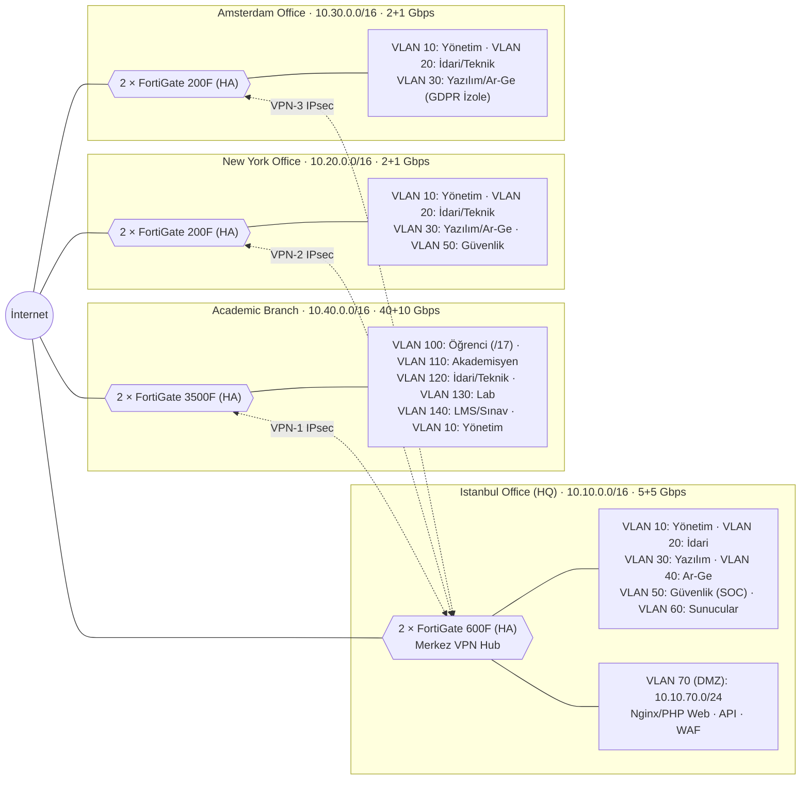
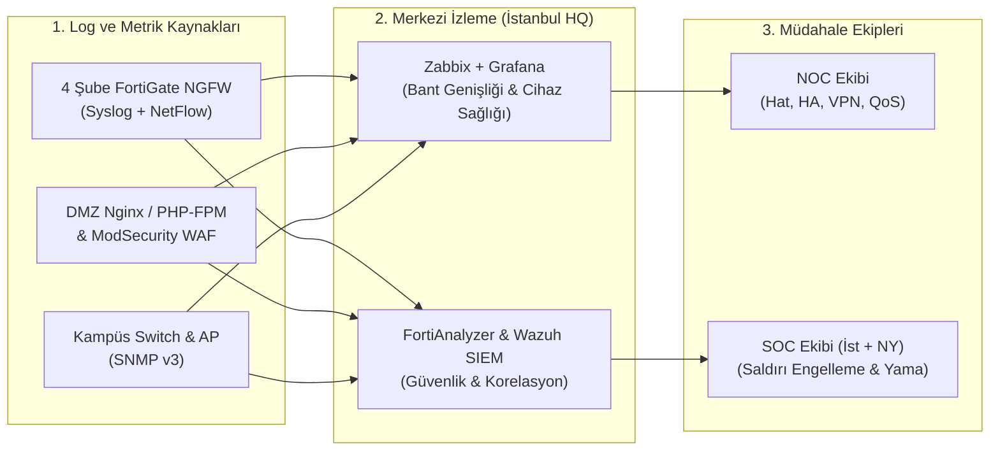

# AegisAI & CyberSystems Global — Kurumsal Ağ Segmentasyonu, Bant Genişliği ve Güvenlik Duvarı Mimarisi

**Ders:** Güvenlik Duvarı Çözümleri (Vize Projesi)  
**Kurum Adı:** AegisAI & CyberSystems Global  
**Faaliyet Alanı:** Yapay Zeka Altyapı Hizmetleri, Kurumsal Yazılım Geliştirme (SaaS/Web) ve Siber Güvenlik Akademisi  

---

## 1. Kurumsal Senaryo ve Şubeler

**AegisAI & CyberSystems Global**, yapay zeka tabanlı yazılım çözümleri geliştiren ve uluslararası ölçekte siber güvenlik eğitimi veren bir teknoloji kuruluşudur. Şirketimiz **4 ana şubeden (3 kurumsal ofis + 1 büyük akademik kampüs)** oluşmaktadır:

| Şube (Branch) | Konum | Toplam Kişi | Temel Rol ve Ağ Karakteristiği |
| :--- | :--- | :---: | :--- |
| **[Istanbul Office (HQ)](#a-istanbul-office-hq--detaylı-yapılandırma)** | İstanbul, Türkiye | **450** | Genel Merkez, Ana Veri Merkezi (ERP, AD, SIEM), DMZ Web/API Sunucuları ve Merkez VPN Hub |
| **[New York Office](#b-new-york-office--detaylı-yapılandırma)** | New York, ABD | **250** | Kuzey Amerika Yazılım Geliştirme, Teknik Destek ve Gece Vardiyası SOC Merkezi |
| **[Amsterdam Office](#c-amsterdam-office--detaylı-yapılandırma)** | Amsterdam, Hollanda | **210** | Avrupa Operasyonları, Ar-Ge Merkezi ve **GDPR** Uyumlu İzole Veri Ağı |
| **[Academic Branch (Antalya)](#d-academic-branch-antalya-kampüsü--detaylı-yapılandırma)** | Antalya, Türkiye | **13,370** | **12,500 Öğrenci**, 450 Akademisyen, Bilgisayar Laboratuvarları, LMS ve Online Sınav Kampüsü |

---

## 2. Şube Bazlı Personel, Bant Genişliği ve Güvenlik Duvarı Matrisi
### (Headcount, bandwidth and firewall matrix per branch)

Aşağıdaki ana tablo; her şubedeki personel/öğrenci dağılımını, eşzamanlı kullanım formülüyle hesaplanan bant genişliği ihtiyacını, birincil + yedek (Primary + Backup) fiber hat kapasitelerini ve her şube için seçilen **Yeni Nesil Güvenlik Duvarı (NGFW - Active/Passive HA)** modellerini göstermektedir:

| Branch | Admin staff | Faculty | Students | Software | Technical | Security | R&D | Total | Required (formula) | Primary + backup link | Selected NGFW (HA) |
| :--- | :---: | :---: | :---: | :---: | :---: | :---: | :---: | :---: | :---: | :---: | :--- |
| **[Istanbul Office](#a-istanbul-office-hq--detaylı-yapılandırma)** | 260 | 0 | 0 | 85 | 45 | 30 | 30 | **450** | 4.65 Gbps | 5 + 5 Gbps | **FortiGate 600F** |
| **[New York Office](#b-new-york-office--detaylı-yapılandırma)** | 150 | 0 | 0 | 40 | 25 | 20 | 15 | **250** | 1.85 Gbps | 2 + 1 Gbps | **FortiGate 200F** |
| **[Amsterdam Office](#c-amsterdam-office--detaylı-yapılandırma)** | 120 | 0 | 0 | 35 | 20 | 15 | 20 | **210** | 1.62 Gbps | 2 + 1 Gbps | **FortiGate 200F** |
| **[Academic Branch](#d-academic-branch-antalya-kampüsü--detaylı-yapılandırma)** | 240 | 450 | **12,500** | 40 | 70 | 25 | 45 | **13,370** | 33.40 Gbps | 40 + 10 Gbps | **FortiGate 3500F** |
| **Total** | **770** | **450** | **12,500** | **200** | **160** | **90** | **110** | **14,280** | **41.52 Gbps** | **49 + 17 Gbps** | **FortiManager (HA)** |

---

## 3. Bant Genişliği (Bandwidth) Hesaplaması ve QoS Politikası

Her şube için gereken bant genişliği; departmandaki kullanıcı sayısı ($N_i$), aynı anda aktif olma oranı ($C_i$), kullanıcı başına gereken ortalama hız ($R_i$) ve **%25 zirve/büyüme güvenlik payı** ($\times 1.25$) formülüyle hesaplanmıştır:

$$B_{\text{required}} = \left( \sum_{i} N_i \times C_i \times R_i + B_{\text{sunucu/vpn}} \right) \times 1.25$$

### Şube Bazlı Bant Genişliği Hesaplama Tablosu

| Şube | Grup / Departman | Kişi ($N$) | Eşzamanlılık ($C$) | Kişi Başı Hız ($R$) | Ham Trafik (Mbps) | Formül Sonucu ($\times 1.25$) | Seçilen Hat (Primary + Backup) |
| :--- | :--- | :---: | :---: | :---: | :---: | :---: | :--- |
| **Istanbul Office** | Admin staff (İdari) | 260 | %75 | 4 Mbps | 780 Mbps | | |
| | Software + R&D (AI/Git/CI-CD) | 115 | %90 | 18 Mbps | 1,863 Mbps | | |
| | Technical + Security (NOC/SOC) | 75 | %85 | 8 Mbps | 510 Mbps | | |
| | Veri Merkezi, DMZ & VPN Hub | — | Sabit | — | 567 Mbps | | |
| | **Istanbul Toplamı** | **450** | | | **3,720 Mbps** | **4.65 Gbps** | **5 + 5 Gbps Fiber** |
| **New York Office** | Admin staff | 150 | %70 | 4 Mbps | 420 Mbps | | |
| | Software + R&D | 55 | %85 | 15 Mbps | 701 Mbps | | |
| | Technical + Security + VPN | 45 | %80 | 6 Mbps + 143 Mbps | 359 Mbps | | |
| | **New York Toplamı** | **250** | | | **1,480 Mbps** | **1.85 Gbps** | **2 + 1 Gbps Fiber** |
| **Amsterdam Office** | Admin staff | 120 | %70 | 4 Mbps | 336 Mbps | | |
| | Software + R&D | 55 | %85 | 15 Mbps | 701 Mbps | | |
| | Technical + Security + VPN | 35 | %80 | 6 Mbps + 91 Mbps | 259 Mbps | | |
| | **Amsterdam Toplamı** | **210** | | | **1,296 Mbps** | **1.62 Gbps** | **2 + 1 Gbps Fiber** |
| **Academic Branch** | Students (Kampüs Wi-Fi & LMS) | 12,500 | %50 | 3.5 Mbps | 21,875 Mbps | | |
| | Faculty (Akademisyenler) | 450 | %75 | 6 Mbps | 2,025 Mbps | | |
| | Admin + Technical + Security | 335 | %75 | 4 Mbps | 1,005 Mbps | | |
| | Software + R&D + Sınav Sunucuları | 85 | %85 | 15 Mbps + 731 Mbps | 1,815 Mbps | | |
| | **Academic Branch Toplamı** | **13,370** | | | **26,720 Mbps** | **33.40 Gbps** | **40 + 10 Gbps Fiber** |

### Trafik Önceliklendirme (QoS / Traffic Shaping) Sınıfları

| QoS Sınıfı | Trafik Türü | Garantili Bant Genişliği | Maksimum Tavan (Ceiling) | Ek Politika ve Kişi Başı Sınırlar |
| :--- | :--- | :---: | :---: | :--- |
| **Sınıf 1 (Gerçek Zamanlı)** | VoIP, Zoom, MS Teams | %20 | %40 | En düşük gecikme (Low Latency) önceliği |
| **Sınıf 2 (İş Kritik & Sınav)** | ERP, LMS, Online Sınav, IPsec VPN | %30 (Sınavda %50) | %65 | Sınav saatlerinde otomatik %50 garanti |
| **Sınıf 3 (Yazılım & Ar-Ge)** | Git, CI/CD, Docker, AI Veri Setleri | %20 | %50 | İstanbul, NY ve Amsterdam geliştirici VLAN'ları |
| **Sınıf 4 (Kurumsal Web)** | HTTPS Gezinme, E-posta, Bulut | %25 | %80 | Standart personel ve akademisyen trafiği |
| **Sınıf 5 (Kısıtlı / Misafir)** | Öğrenci Genel Web, Video, Misafir | %5 | %15 | **Öğrenci:** 15/5 Mbps limit, P2P/Torrent engelli **Misafir:** 5/2 Mbps limit, 4 saat oturum |

---

## 4. Ağ Ayırma (VLAN Planlaması) ve Topoloji
                                                                                                                                                                                                                                    
Mimari **Hub-and-Spoke (Merkez ve Uçlar)** yapısındadır. İstanbul Merkez (`10.10.0.0/16`) ana VPN Hub'dır; New York (`10.20.0.0/16`), Amsterdam (`10.30.0.0/16`) ve Antalya Akademik Şube (`10.40.0.0/16`) şifreli **IPsec IKEv2** tünelleriyle İstanbul'a bağlanır.

### Tüm Şubeler İçin VLAN ve Alt Ağ (Subnet) Ayırma Tablosu

| Şube (Branch) | Ana Blok | VLAN ID | Alt Ağ (Subnet) | Kullanılabilir IP | Departman / Kullanım Amacı |
| :--- | :--- | :---: | :--- | :---: | :--- |
| **Istanbul Office** | `10.10.0.0/16` | **VLAN 10** | `10.10.10.0/24` | 254 | Ağ Cihazları, Firewall ve Sunucu Yönetimi (Management) |
| **Istanbul Office** | | **VLAN 20** | `10.10.20.0/23` | 510 | Admin staff (260) + Technical (45) Personel Ağı |
| **Istanbul Office** | | **VLAN 30** | `10.10.30.0/24` | 254 | Software (85) Yazılım Geliştirme Ekibi |
| **Istanbul Office** | | **VLAN 40** | `10.10.40.0/24` | 254 | R&D (30) Yapay Zeka Ar-Ge Ekibi |
| **Istanbul Office** | | **VLAN 50** | `10.10.50.0/24` | 254 | Security (30) SOC ve Siber Güvenlik Ekibi |
| **Istanbul Office** | | **VLAN 60** | `10.10.60.0/24` | 254 | İç Sunucular (ERP, Active Directory, Git, Merkezi SIEM) |
| **Istanbul Office** | | **VLAN 70 (DMZ)** | `10.10.70.0/24` | 254 | Dışa Açık Web (Nginx/PHP), API ve Mail Gateway (**İç ağdan izole**) |
| **New York Office** | `10.20.0.0/16` | **VLAN 10** | `10.20.10.0/24` | 254 | Şube Cihaz Yönetimi (Management) |
| **New York Office** | | **VLAN 20** | `10.20.20.0/24` | 254 | Admin staff (150) + Technical (25) Personel |
| **New York Office** | | **VLAN 30** | `10.20.30.0/24` | 254 | Software (40) + R&D (15) Geliştirici Ağı |
| **New York Office** | | **VLAN 50** | `10.20.50.0/24` | 254 | Security (20) ABD SOC Ekibi |
| **Amsterdam Office** | `10.30.0.0/16` | **VLAN 10** | `10.30.10.0/24` | 254 | Şube Cihaz Yönetimi (Management) |
| **Amsterdam Office** | | **VLAN 20** | `10.30.20.0/24` | 254 | Admin staff (120) + Technical (20) (GDPR Korumalı) |
| **Amsterdam Office** | | **VLAN 30** | `10.30.30.0/24` | 254 | Software (35) + R&D (20) + Security (15) |
| **Academic Branch** | `10.40.0.0/16` | **VLAN 100** | `10.40.0.0/17` | **32,766** | **Students (12,500 Öğrenci)** – Kişi başı ~2 cihaz (25.000 IP) için `/17` blok |
| **Academic Branch** | | **VLAN 110** | `10.40.128.0/22` | 1,022 | Faculty (450 Akademisyen) |
| **Academic Branch** | | **VLAN 120** | `10.40.132.0/23` | 510 | Admin (240) + Technical (70) + Security (25) Kampüs Personeli |
| **Academic Branch** | | **VLAN 130** | `10.40.136.0/22` | 1,022 | Software (40) + R&D (45) + Öğrenci Bilgisayar Laboratuvarları |
| **Academic Branch** | | **VLAN 140** | `10.40.140.0/24` | 254 | LMS ve Online Sınav Sunucuları |
| **Academic Branch** | | **VLAN 10** | `10.40.141.0/24` | 254 | Kampüs Ağ Yönetimi (`10.40.0.0/17` öğrenci bloğuyla çakışmaması için `.141.0`) |
| **Istanbul Office** | | **VLAN 99** | `10.10.99.0/24` | 254 | Misafir Ağı (Sadece İnternet çıkışı, iç ağlara ve VPN'e erişim engelli) |
| **New York Office** | | **VLAN 99** | `10.20.99.0/24` | 254 | Misafir Ağı (Sadece İnternet) |
| **Amsterdam Office** | | **VLAN 99** | `10.30.99.0/24` | 254 | Misafir Ağı (Sadece İnternet) |
| **Academic Branch** | | **VLAN 99** | `10.40.142.0/24` | 254 | Misafir Ağı (Sadece İnternet) |

---

## 5. Şube Bazlı Güvenlik Duvarı (Firewall) Seçimi, Top 5 Listesi ve Kurallar

### Güvenlik Duvarı Seçim Kriterleri ve Neden Basit Firewall (UFW) Yetmez?

1. **Threat Protection Kapasitesi ($\ge \text{Hat Hızı} \times 1.5\text{–}2$):** Güvenlik duvarı üzerinde IPS, Antivirüs ve SSL/TLS Şifre Çözme (Inspection) açıldığında cihazın gerçek performansı (*Threat Protection Throughput*) ciddi şekilde düşer. Bu yüzden seçilen her cihazın Threat Protection hızı, şube internet hattının üzerinde seçilmiştir.
2. **Neden UFW / Basit Firewall Kullanılamaz?**
   * **Oturum ve Hız Sınırı:** Akademik şubede 12.500 öğrenciden geçen **33.40 Gbps** trafiği ve milyonlarca eşzamanlı oturumu yazılımsal `UFW` işleyemez; donanımsal ASIC çipli **NGFW** zorunludur.
   * **Katman 7 (Application Layer) Zafiyetleri ve WAF İhtiyacı:** Örneğin DMZ'deki web sunucularımızda çalışan **PHP / FrankenPHP / Nginx** altyapısında ortaya çıkabilecek kritik bir **Bellek Bozulması (Memory Corruption $\rightarrow$ CVSS 9.2 RCE / Uzaktan Kod Çalıştırma)** açığını düşünelim. Saldırgan bu açığı tetiklemek için TCP 443 (HTTPS) üzerinden özel bir HTTP payload'u göndererek PHP bellek limitini taşırır. `UFW` veya sadece port kontrolü yapan bir güvenlik duvarı 443 portu açık olduğu için bu saldırıyı **kesinlikle engelleyemez**. Hatta standart **Cloudflare** paketi bile arkadaki sunucunun PHP bellek limitini bilmediği için büyük boyutlu (200–300 MB) istismar isteklerini geçirebilir. Bu nedenle ağ güvenlik duvarının (FortiGate NGFW) yanı sıra, web sunucularının önünde **WAF (ModSecurity / FortiWeb + Cloudflare WAF)** kuralları ve sunucu düzeyinde **hızlı paket güncellemesi (`apt update && apt upgrade`)** birlikte uygulanmaktadır.

---

### A) Istanbul Office (HQ) – Detaylı Yapılandırma
* **Kullanıcı ve Bant Genişliği:** 450 Kişi | Hesaplanan: **4.65 Gbps** | Hat: **5 + 5 Gbps** | Gerekli Min. Threat Protection: **$\ge 9\text{ Gbps}$**

#### Istanbul Office İçin En Uygun Top 5 Firewall Adayı
| Sıra | Model | Threat Protection Hızı | IPsec VPN Hızı | Yaklaşık Maliyet (HA Çifti) | Değerlendirme ve Seçim Gerekçesi |
| :---: | :--- | :---: | :---: | :---: | :--- |
| **1** | **FortiGate 600F (HA) [SEÇİLDİ]** | **10.5 Gbps** | **55 Gbps** | **~\$38,000** | 5+5 Gbps hat ve Merkez VPN Hub rolü için en yüksek fiyat/performans |
| **2** | Palo Alto PA-3430 (HA) | 9.5 Gbps | 11 Gbps | ~\$62,000 | Çok güçlü App-ID yeteneği ancak maliyeti yüksek |
| **3** | Check Point Quantum 6900 (HA) | 9.2 Gbps | 18 Gbps | ~\$54,000 | Güçlü merkezi yönetim (SmartConsole) |
| **4** | Cisco Secure Firewall 3130 (HA) | 10.2 Gbps | 14 Gbps | ~\$58,000 | Cisco omurga ağlarıyla uyumlu |
| **5** | FortiGate 400F (HA) | 9.0 Gbps | 55 Gbps | ~\$26,000 | Ekonomik alternatif (5 Gbps sınırında çalıştığı için 600F tercih edildi) |

#### Istanbul Office Güvenlik Duvarı Kuralları (ACL)
| # | Kaynak (Source) | Hedef (Destination) | Servis / Port | İşlem | Açıklama |
| :---: | :--- | :--- | :--- | :---: | :--- |
| **1** | Yönetim (`VLAN 10`) | Tüm Cihaz Yönetim IP'leri | SSH (22), HTTPS (443) | **ALLOW** | Sadece Sistem Yöneticileri + SSH Key & MFA |
| **2** | İnternet (`Any`) | DMZ Web/PHP/API (`VLAN 70`) | HTTPS (443), SMTP (25) | **ALLOW** | **DNAT + ModSecurity/FortiWeb WAF + IPS Aktif** (RCE/Memory limit koruması) |
| **3** | DMZ (`VLAN 70`) | Tüm İç Ağlar (`10.0.0.0/8`) | Any | **DENY + LOG** | DMZ sunucusu ele geçirilirse iç ağa sızmayı engeller |
| **4** | İdari (`VLAN 20`) | İç Sunucular (`VLAN 60`) | ERP (8443), LDAPS, IMAPS | **ALLOW** | İdari personel sadece kurumsal servislere erişir |
| **5** | Yazılım (`30`) & Ar-Ge (`40`) | Git / CI-CD / AI Sunucuları (`VLAN 60`) | SSH (22), HTTPS (443) | **ALLOW** | Geliştiriciler İdari VLAN 20'ye erişemez (İzole) |
| **6** | Güvenlik SOC (`VLAN 50`) | Tüm Şube Firewall & SIEM Sunucuları | HTTPS (443), Syslog (6514), SNMP | **ALLOW** | Merkezi izleme ve müdahale yetkisi |
| **7** | Şube VPN Ağları (NY, AMS, Akademi) | İç Sunucular (`VLAN 60`) | ERP, HTTPS, SMB, Syslog | **ALLOW** | Şubelerden gelen yetkili VPN trafiğinin merkez karşılık kuralı |
| **8** | İç VLAN'lar (`20–60`) ve Misafir (`99`) | İnternet (`WAN`) | HTTP/HTTPS, DNS | **ALLOW** | Web Filtresi + QoS (Misafir iç ağlara kapalıdır) |
| **9** | Any | Any | Any | **DENY + LOG** | Varsayılan Kural (Implicit Deny) |

---

### B) New York Office – Detaylı Yapılandırma
* **Kullanıcı ve Bant Genişliği:** 250 Kişi | Hesaplanan: **1.85 Gbps** | Hat: **2 + 1 Gbps** | Gerekli Min. Threat Protection: **$\ge 3\text{ Gbps}$**

#### New York Office İçin En Uygun Top 5 Firewall Adayı
| Sıra | Model | Threat Protection Hızı | IPsec VPN Hızı | Yaklaşık Maliyet (HA Çifti) | Değerlendirme ve Seçim Gerekçesi |
| :---: | :--- | :---: | :---: | :---: | :--- |
| **1** | **FortiGate 200F (HA) [SEÇİLDİ]** | **3.0 Gbps** | **13 Gbps** | **~\$14,500** | 2+1 Gbps hat için tam kapasite, dahili SD-WAN ve İstanbul ile tam uyum |
| **2** | Palo Alto PA-1410 (HA) | 3.2 Gbps | 4.2 Gbps | ~\$24,000 | Güçlü tehdit önleme, daha yüksek lisans maliyeti |
| **3** | Check Point Quantum 3800 (HA) | 3.0 Gbps | 6.5 Gbps | ~\$21,000 | Güvenilir şube güvenliği |
| **4** | Sophos XGS 3300 (HA) | 3.1 Gbps | 6.0 Gbps | ~\$13,000 | Kolay yönetim arayüzü |
| **5** | Cisco Secure Firewall 1220 (HA) | 3.3 Gbps | 5.0 Gbps | ~\$19,500 | Kurumsal şube alternatifi |

#### New York Office Güvenlik Duvarı Kuralları (ACL)
| # | Kaynak (Source) | Hedef (Destination) | Servis / Port | İşlem | Açıklama |
| :---: | :--- | :--- | :--- | :---: | :--- |
| **1** | İdari (`VLAN 20`) & Yazılım/Ar-Ge (`30`) | İstanbul Sunucular (`VLAN 60` - VPN) | ERP (8443), HTTPS, Git (22) | **ALLOW** | IPsec VPN üzerinden merkez sunucu erişimi |
| **2** | NY Güvenlik SOC (`VLAN 50`) | İstanbul SIEM & Tüm Firewall'lar (VPN) | HTTPS (443), SSH (22) | **ALLOW** | ABD gece vardiyası SOC ekibi izleme yetkisi |
| **3** | İç VLAN'lar (`20, 30, 50`) & Misafir (`99`) | İnternet (`WAN`) | HTTP/HTTPS, DNS | **ALLOW** | Web Filtresi + QoS (Misafir iç ağlardan izole) |
| **4** | Any | Any | Any | **DENY + LOG** | Varsayılan Kural |

---

### C) Amsterdam Office – Detaylı Yapılandırma
* **Kullanıcı ve Bant Genişliği:** 210 Kişi | Hesaplanan: **1.62 Gbps** | Hat: **2 + 1 Gbps** | Gerekli Min. Threat Protection: **$\ge 3\text{ Gbps}$**

#### Amsterdam Office İçin En Uygun Top 5 Firewall Adayı
| Sıra | Model | Threat Protection Hızı | IPsec VPN Hızı | Yaklaşık Maliyet (HA Çifti) | Değerlendirme ve Seçim Gerekçesi |
| :---: | :--- | :---: | :---: | :---: | :--- |
| **1** | **FortiGate 200F (HA) [SEÇİLDİ]** | **3.0 Gbps** | **13 Gbps** | **~\$14,500** | 1.62 Gbps ihtiyaç için ideal, DLP ve GDPR raporlama desteği |
| **2** | Palo Alto PA-1410 (HA) | 3.2 Gbps | 4.2 Gbps | ~\$24,000 | Güçlü uygulama kontrolü |
| **3** | Check Point Quantum 3600 (HA) | 2.6 Gbps | 5.0 Gbps | ~\$18,500 | Avrupa uyumluluk raporlamasında başarılı |
| **4** | Sophos XGS 3300 (HA) | 3.1 Gbps | 6.0 Gbps | ~\$13,000 | Uç nokta (EDR) senkronizasyonu |
| **5** | WatchGuard Firebox M590 (HA) | 2.9 Gbps | 6.8 Gbps | ~\$12,500 | Ekonomik şube alternatifi |

#### Amsterdam Office Güvenlik Duvarı Kuralları (ACL)
| # | Kaynak (Source) | Hedef (Destination) | Servis / Port | İşlem | Açıklama |
| :---: | :--- | :--- | :--- | :---: | :--- |
| **1** | Personel (`VLAN 20`) & Ar-Ge (`VLAN 30`) | İstanbul Sunucular (`VLAN 60` - VPN) | ERP (8443), HTTPS, Git | **ALLOW** | Merkez erişimi |
| **2** | İnternet ve Diğer Şubeler | Amsterdam İç Ağı (`10.30.0.0/16`) | Any | **DENY + LOG** | **GDPR Kuralı:** AB personel ve müşteri verilerine dışarıdan erişim yasak |
| **3** | İç VLAN'lar (`20, 30`) & Misafir (`99`) | İnternet (`WAN`) | HTTP/HTTPS, DNS | **ALLOW** | DLP (Veri Sızıntısı Önleme) + Web Filtresi |
| **4** | Any | Any | Any | **DENY + LOG** | Varsayılan Kural |

---

### D) Academic Branch (Antalya Kampüsü) – Detaylı Yapılandırma
* **Kullanıcı ve Bant Genişliği:** 13,370 Kişi (12,500 Öğrenci) | Hesaplanan: **33.40 Gbps** | Hat: **40 + 10 Gbps** | Gerekli Min. Threat Protection: **$\ge 50\text{ Gbps}$**

#### Academic Branch İçin En Uygun Top 5 Firewall Adayı
| Sıra | Model | Threat Protection Hızı | Eşzamanlı Oturum | Yaklaşık Maliyet (HA Çifti) | Değerlendirme ve Seçim Gerekçesi |
| :---: | :--- | :---: | :---: | :---: | :--- |
| **1** | **FortiGate 3500F (HA) [SEÇİLDİ]** | **63 Gbps** | **70 Milyon** | **~\$165,000** | 40+10 Gbps kampüs hattını tüm güvenlik profilleri (IPS + SSL Inspection) açıkken dahi dar boğaz olmadan taşır |
| **2** | Palo Alto PA-5440 (HA) | 54 Gbps | 32 Milyon | ~\$240,000 | Çok yüksek güvenlik kalitesi ancak maliyeti çok yüksek |
| **3** | Check Point Quantum 16600 (HA) | 52 Gbps | 40 Milyon | ~\$195,000 | Büyük kampüs ve veri merkezi alternatifi |
| **4** | Cisco Secure Firewall 4245 (HA) | 60 Gbps | 50 Milyon | ~\$210,000 | Yüksek 40G/100G port yoğunluğu |
| **5** | Juniper SRX5400 (HA) | 50 Gbps | 45 Milyon | ~\$180,000 | Yüksek yönlendirme kapasitesi |

#### Academic Branch Güvenlik Duvarı Kuralları (ACL)
| # | Kaynak (Source) | Hedef (Destination) | Servis / Port | İşlem | Açıklama |
| :---: | :--- | :--- | :--- | :---: | :--- |
| **1** | Öğrenci (`VLAN 100`) & Lab (`VLAN 130`) | Kampüs LMS / Sınav (`VLAN 140`) | HTTPS (443) | **ALLOW** | Sınav saatlerinde %50 QoS garantisi (Kural 2'nin üstünde olmalı!) |
| **2** | Öğrenci (`VLAN 100`) | Tüm Kurumsal Özel Ağlar (`10.0.0.0/8`) | Any | **DENY + LOG** | **Tam İzolasyon:** Öğrenciler Akademisyen, İdari ve VPN ağlarına erişemez |
| **3** | Öğrenci (`VLAN 100`) | İnternet (`WAN`) | HTTP/HTTPS, DNS | **ALLOW** | Kişi başı 15/5 Mbps hız sınırı, P2P/Torrent engelli, Web Filtresi |
| **4** | Akademisyen (`VLAN 110`) | LMS (`140`) + İstanbul Sunucular (VPN) | HTTPS (443), SMB (445) | **ALLOW** | Not girişi ve akademik veri paylaşımı |
| **5** | Kampüs İdari/Teknik (`VLAN 120`) | İstanbul ERP Sunucusu (VPN) | ERP (8443), HTTPS | **ALLOW** | Öğrenci işleri ve kampüs yönetimi |
| **6** | Akademisyen (`110`) & İdari (`120`) | İnternet (`WAN`) | HTTP/HTTPS, DNS | **ALLOW** | Standart kurumsal çıkış |
| **7** | Siber Lab (`VLAN 130`) | İnternet (`WAN`) | HTTP/HTTPS | **ALLOW** | Sınav saatlerinde otomatik olarak kapatılır (Sadece LMS açık kalır) |
| **8** | Misafir (`VLAN 99`) | Tüm Kurumsal Ağlar (`10.0.0.0/8`) | Any | **DENY + LOG** | Misafir iç ağ izolasyonu |
| **9** | Misafir (`VLAN 99`) | İnternet (`WAN`) | HTTP/HTTPS, DNS | **ALLOW** | 5/2 Mbps limit, Captive Portal |
| **10** | Any | Any | Any | **DENY + LOG** | Varsayılan Kural |

---

## 6. İzleme (Monitoring) Nasıl Yapılacak? (NOC, SOC ve SIEM)

Tüm şubelerdeki güvenlik duvarları, switch'ler ve DMZ sunucuları; **İstanbul (`VLAN 50`)** ve **New York (`VLAN 50`)** güvenlik ekipleri tarafından **7/24** izlenir.

### İzleme Katmanları, Araçlar ve Kritik Alarm Eşik Değerleri (Thresholds)

| İzleme Alanı | Kullanılan Araçlar | İzlenen Metrik ve Alarm Eşiği (Threshold) | Otomatik / Manuel Müdahale Aksiyonu |
| :--- | :--- | :--- | :--- |
| **1. Bant Genişliği ve Trafik İzleme** | **FortiAnalyzer + ntopng (NetFlow/sFlow)** | • Şube hatlarının anlık doluluk oranı. • **Eşik:** Hat kullanımının 15 dk boyunca **>%80** olması. | NOC uyarılır; QoS Sınıf 5 (öğrenci video/misafir) tavanı daraltılır, DDoS varsa Rate Limiting uygulanır. |
| **2. Donanım, HA ve VPN İzleme** | **Zabbix + Grafana (SNMP v3)** | • Firewall CPU, RAM, sıcaklık ve tünel durumu. • **Eşik:** CPU **>%85** olması veya **VPN tünelinin 30 sn kopması**. | Birincil hat koptuğunda Backup hat üzerindeki ikinci IPsec VPN tüneli otomatik devreye girer (Failover). |
| **3. İç Ağ Sızma ve Brute-Force İzleme** | **Wazuh SIEM + FortiManager** | • Firewall `DENY` logları ve hatalı girişler. • **Eşik:** Öğrenci VLAN 100'den iç ağlara **10 dk içinde >15 deneme** veya **5 hatalı admin girişi**. | Kaynak IP otomatik bloklanır; öğrenci cihazının 802.1X Wi-Fi oturumu düşürülür ve SOC Tier 1 inceler. |
| **4. Uygulama Katmanı (WAF & PHP RCE) İzleme** | **ModSecurity + Wazuh Log Agent** | • DMZ Nginx/PHP-FPM bellek hatası logları (`Allowed memory size exhausted`) ve WAF alarmları. • **Eşik:** **1 adet** RCE / Memory Corruption istismar girişimi. | Saldırgan IP anında FortiGate ve Cloudflare WAF üzerinde kalıcı bloklanır; sunucuda acil yama (`apt update && apt upgrade`) uygulanır. |

### Periyodik Operasyon ve Bakım Süreçleri
* **Haftalık:** Şube bazlı bant genişliği zirve (Peak) kullanım raporlarının incelenmesi ve tüm FortiGate kurallarının **FortiManager** üzerinden otomatik yedeklenmesi.
* **Aylık:** 90 gündür hiç trafik geçmeyen (*Unused*) veya üstteki bir kural tarafından ezilen (*Shadowed*) kuralların temizlenmesi; FortiOS ve sunucu (PHP/Linux) güvenlik yamalarının geçilmesi.
