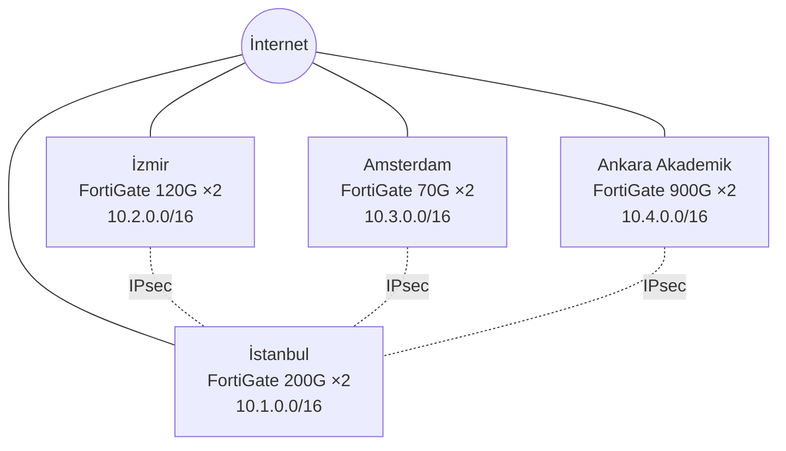

# Atlas Holding: Ağ ve Güvenlik Duvarı Planı

Atlas Holding hayali bir şirkettir. Kurumlar için iş yazılımları geliştirir, Avrupa'da satış yapar ve Ankara'da 10.000 öğrencili bir yükseköğretim kampüsü işletir. Yönetim ve yazılım ekibinin çoğu İstanbul'da, Ar-Ge İzmir'de, Avrupa satış ekibi Amsterdam'dadır.

Bu dört yerin ihtiyacı birbirinden çok farklı. İzmir araştırma verisini korumak, Amsterdam kişisel veriyi Avrupa'da tutmak, kampüs ise binlerce güvenilmeyen cihazı iç sistemlerden ayırmak zorunda. Bu yüzden her şubenin kişi sayısını, bant genişliğini, VLAN yapısını, güvenlik duvarını, kurallarını ve izlenme biçimini ayrı ayrı planladık.

Her şubenin detayları kendi klasöründedir:

| Şube | Rol | Detay |
|---|---|---|
| İstanbul | Genel merkez, VPN merkezi, ERP ve SOC | [01-istanbul](01-istanbul/README.md) |
| İzmir | Ar-Ge merkezi | [02-izmir](02-izmir/README.md) |
| Amsterdam | Yurt dışı satış ofisi, GDPR kapsamında | [03-amsterdam](03-amsterdam/README.md) |
| Ankara Akademik | Kampüs: öğrenci, hoca ve personel | [04-ankara-akademik](04-ankara-akademik/README.md) |

Tasarımın diğer parçaları:

| Dosya | İçerik |
|---|---|
| [company.json](company.json) | Dersin şemasına uygun özet. Kurallar burada somut adreslerle yazılıdır |
| [NESNELER.md](NESNELER.md) | Kural tablolarındaki her adın üyeleri ve adresleri ([nesneler.json](nesneler.json)) |
| [ngfw-profilleri.json](ngfw-profilleri.json) | Uygulama denetimi profilleri. L3/L4 kuralı değildir |
| [sunucu-akislari.json](sunucu-akislari.json) | Aynı VLAN içinde izin verilen sunucu akışları |
| [waf/README.md](waf/README.md) | WAF kapasite doğrulama planı |
| [lab/README.md](lab/README.md) | Testler, gerçekten çalıştırılan sonuçlar ve sınırlar |

## 1. Özet tablo

| Şube | Personel | Hoca | Öğrenci | Yazılım | Teknik | Ar-Ge | Toplam | Gereken | ×1,25 | Ana + yedek hat | Güvenlik duvarı (HA) |
|---|---:|---:|---:|---:|---:|---:|---:|---:|---:|---:|---|
| İstanbul | 250 | 0 | 0 | 60 | 25 | 15 | **350** | 1,26 Gbps | 1,58 Gbps | 2 + 1 Gbps | FortiGate 200G ×2 |
| İzmir | 120 | 0 | 0 | 25 | 12 | 40 | **197** | 0,92 Gbps | 1,15 Gbps | 2 + 1 Gbps | FortiGate 120G ×2 |
| Amsterdam | 80 | 0 | 0 | 20 | 8 | 0 | **108** | 0,36 Gbps | 0,45 Gbps | 500 + 250 Mbps | FortiGate 70G ×2 |
| Ankara Akademik | 200 | 400 | 10.000 | 10 | 30 | 20 | **10.660** | 5,18 Gbps | 6,48 Gbps | 10 + 5 Gbps | FortiGate 900G ×2 |
| **Toplam** | **650** | **400** | **10.000** | **115** | **75** | **75** | **11.315** | **7,72 Gbps** | **9,65 Gbps** | **14,5 + 7,25 Gbps** | |

Sayıların dayanağı:

- **Hoca:** 25 öğrenciye 1 hoca (10.000 / 25 = 400).
- **Akademik personel:** 50 öğrenciye 1 personel (10.000 / 50 = 200).
- **Teknik ekip:** Ofislerde yaklaşık 10-15 çalışana 1 kişi. Kampüste kişi sayısı öğrenci nedeniyle çok yüksek olduğu için 30 kişilik ayrı bir ekip var.
- **Yazılım ve Ar-Ge:** Yazılımın ağırlığı İstanbul'da, Ar-Ge'nin ağırlığı İzmir'dedir.

## 2. Bant genişliği

Hattı kişi sayısına göre değil, her grubun aynı anda ne kadar kullandığına göre boyutlandırdık. 10.000 öğrenci kalabalık görünür, ama küçük bir Ar-Ge ekibinin kişi başına tüketimi çok daha yüksektir. Formül bu farkı görünür kılar.

```text
Gereken hız = Kişi × Kişi başı hız × Eşzamanlılık
Ana hat     = Gereken hız × 1,25, sonra satılan bir üst hız
Yedek hat   = Ana hattın yarısı
```

| Grup | Kişi başı | Eşzamanlılık | Etkin hız | Neden bu değer? |
|---|---:|---:|---:|---|
| Personel | 3 Mbps | %70 | 2,1 Mbps | E-posta, SaaS ve görüntülü görüşme |
| Hoca | 3 Mbps | %50 | 1,5 Mbps | Derste ve ofiste dönüşümlü kullanım |
| Öğrenci | 1,5 Mbps | %25 | 0,375 Mbps | Hepsi aynı anda kampüste ve çevrimiçi olmaz |
| Yazılım | 10 Mbps | %80 | 8 Mbps | Git, paket indirme ve bulut ortamları |
| Teknik | 5 Mbps | %80 | 4 Mbps | Güncelleme, uzak bağlantı ve yedekleme |
| Ar-Ge | 15 Mbps | %70 | 10,5 Mbps | Büyük veri setleri ve test ortamları |

Bu değerler ölçüm değil, planlama varsayımıdır. Kuruluştan sonra Zabbix verisiyle gerçek kullanıma göre güncellenir.

**1,25 çarpanı** iki şeyi karşılar: büyüme ve hattın sürekli tam dolu çalışmaması gereği.

**Yükleme hızı:** Hatların simetrik fiber olduğunu, yani yükleme hızının indirme hızına eşit olduğunu varsaydık. Şube tünelleri ve DMZ yayınları yükleme de kullandığı için bu önemlidir.

**Yedek hat yetiyor mu?** Ana hat koparsa yedek hat ihtiyacın şu kadarını karşılar:

| Şube | Gereken | Yedek hat | Karşılama | Plan |
|---|---:|---:|---:|---|
| İstanbul | 1,26 Gbps | 1 Gbps | %79 | Kritik uygulamalar öncelikli, diğer trafik sınırlanır |
| İzmir | 0,92 Gbps | 1 Gbps | %100 | Normal çalışma |
| Amsterdam | 0,36 Gbps | 250 Mbps | %69 | Görüşme ve iş uygulamaları öncelikli |
| Ankara Akademik | 5,18 Gbps | 5 Gbps | %97 | Öğrenci trafiği 3 Gbps ile sınırlanır, toplam 4,43 Gbps'e iner |

**VLAN başına bant genişliği:** Her şubenin tablosu klasöründedir ve güvenlik duvarında trafik şekillendirme ile uygulanır.

- **Garanti:** Grubun yukarıda hesaplanan ihtiyacına göre verilir. Sunucu ve DMZ trafiği kişi hesabında olmadığı için ayrıca eklenir. Toplam garanti ana hattı aşamaz.
- **En yüksek:** Hat boşken grubun çıkabileceği sınırdır. Böylece tek bir grup bütün hattı dolduramaz.
- **Yedek hatta:** Ana hat koptuğunda geçerli olan sınırdır. Bu değerlerin toplamı yedek hattın hızına eşittir.
- **Ar-Ge:** İnternete proxy ile çıktığı için sınır proxy kuralına uygulanır.
- **IoT:** İnternete çıkmadığı için tabloda yoktur.

## 3. Ağ yapısı

Ağı kata veya binaya göre değil, role göre böldük. Amaç, bir cihaz ele geçirilirse hasarı o VLAN içinde tutmaktır: öğrenci dizüstü bilgisayarı ERP'yi, kamera da personel ağını görmemelidir.

Şubeler İstanbul merkezli IPsec tünellerle bağlanır. Her şubede farklı operatörlerden iki hat ve aktif-pasif çalışan iki güvenlik duvarı vardır.



**Ortak VLAN düzeni:**

| VLAN | Ağ | Neden ayrı? |
|---:|---|---|
| 10 | Yönetim | Güvenlik duvarı ve switch yönetimine kullanıcı ağından erişilmemeli |
| 20 | Personel | Standart ofis trafiği |
| 30 | Yazılım | Git ve geliştirme erişimi personelden farklıdır |
| 40 | Ar-Ge | Fikri mülkiyet korunur, internete yalnızca proxy ile çıkılır |
| 50 | Teknik | Altyapıya yetkili erişimi olan ekip |
| 60 | Sunucu | Altyapı ve uygulama sunucuları kullanıcı ağından ayrılır |
| 61 | Yönetim araçları | Yalnızca İstanbul: bastion ve izleme, uygulama sunucusu ele geçirilse de ayrı kalır |
| 63 | Veri | İstanbul ve Akademik: veritabanına yalnızca kendi uygulaması ulaşır |
| 64 | Sınır servisleri | Proxy ve kamera kayıt: internete veya kameralara değen sunucular iç sunuculardan ayrılır |
| 70 | DMZ | İnternete açık servisler iç ağdan ayrılır |
| 80 | IoT | Kamera, yazıcı ve kartlı geçiş internete çıkmaz |
| 85 | Misafir | Yalnızca internete çıkar, iç ağa erişemez |
| 90 | Hoca | Yalnızca Akademik: not sistemi erişimi |
| 100-107 | Öğrenci | Yalnızca Akademik: bina başına bir VLAN, internet ve LMS |
| 110 | Laboratuvar | Yalnızca Akademik: riskli denemeler kampüs ağından ayrılır |

**Adres hesabı:** `Kişi × 2 cihaz × 1,3 büyüme`. Sonuca yeten en küçük alt ağ seçilir. Öğrencilerde kişi başına 2,5 cihaz kullanılır. VLAN numarası, mümkün olduğunda IP adresinin üçüncü bölümüyle aynıdır; örneğin `10.2.40.0/25` İzmir VLAN 40'tır. Öğrenci ve hoca ağları büyük olduğu için bu kuralın dışındadır.

**Öğrenci ağı:** `10.4.128.0/17` bir VLAN değil, adres rezervi ve kural özetidir. Gerçek ağlar sekiz `/20` VLAN'dır. Kapasite hesabı ve büyüme planı [Ankara dosyasındadır](04-ankara-akademik/README.md#öğrenci-ağı).

**Yönlendirme:** Her şube bütün özel adresleri (`10.0.0.0/8`) İstanbul tüneline yollar, İstanbul her şube bloğunu kendi tüneline yönlendirir. Şubeler arasında doğrudan tünel yoktur, bu yüzden şubeden şubeye her paket iki güvenlik duvarından geçer ve izin yoksa ilkinde durur.

| Tünel | İstanbul ucu | Şube ucu | Şube bloğu |
|---|---|---|---|
| İstanbul - İzmir | `tunel-ist-izm` | `tunel-izmir` | `izm-tum` |
| İstanbul - Amsterdam | `tunel-ist-ams` | `tunel-amsterdam` | `ams-tum` |
| İstanbul - Ankara | `tunel-ist-ank` | `tunel-ankara` | `ank-tum` |

**NAT:** İç ağların internet çıkışı WAN adresine çevrilir (SNAT). İnternetten gelen HTTPS, WAF sanal adresine çevrilir (DNAT):

| WAN adresi | Port | Hedef |
|---|---|---|
| `wan-istanbul` | tcp/443 | `ist-waf-vip` |
| `wan-ankara` | tcp/443 | `ank-waf-vip` |

İzmir ve Amsterdam'da DNAT yoktur. Gerçek WAN adresleri operatörden alınır, burada tanımlı değildir. IPsec şifreleme parametreleri henüz yazılmadı.

## 4. Güvenlik duvarı seçimi

Datasheet'in başındaki büyük hız, güvenlik özellikleri kapalıyken ölçülür. Biz IPS ve benzeri korumalar açıkken ölçülen hıza baktık, çünkü gerçekte kullanacağımız değer odur.

**Seçim kuralı:** Güvenlik özellikleri açıkken ölçülen hız, ana hattan düşük olamaz. HA çifti aktif-pasif çalıştığı için hız ikiye katlanmaz ve hesap tek cihaza göre yapılır.

**İkinci kontrol:** Seçilen model, TLS denetimi hızı ve eşzamanlı oturum sayısına göre de doğrulanır. Şube klasörlerindeki hesaplar şu planlama varsayımlarını kullanır:

- **TLS denetimi:** TLS denetimi açık grupların gereken hızı × 1,25.
- **Oturum:** Kurum cihazı başına 100, öğrenci cihazı başına 50 eşzamanlı oturum, üzerine 1,3 büyüme payı. Kurum çalışanı başına 2 cihaz sayılır.

Her şube için beş marka karşılaştırıldı: Fortinet, Palo Alto, Check Point, Cisco ve Sophos. Tablolar şube klasörlerindedir. Tablolardaki **Hat yükü**, ana hat tam doluyken cihaz kapasitesinin yüzde kaçının kullanıldığını gösterir.

**Neden dört şubede de Fortinet?**

- Tek panelden (FortiManager) yönetim, VPN ve SD-WAN kurulumu kolaylaşır.
- Teknik ekip tek bir sistem öğrenir ve yanlış yapılandırma riski azalır.
- Hiçbir şubede en ucuz seçenek değildir. Tek yönetim, büyüme payı ve doğrulanabilir kapasite için bu farkı kabul ettik.

**Bu kararın riski:** Tek markadaki bir açık bütün şubeleri etkileyebilir. Bu yüzden yönetim arayüzleri internete kapalıdır, yönetim yalnızca MFA'lı VPN ve bastion üzerinden yapılır, güvenlik yamaları için takip süreci vardır.

**Değerlendirip almadıklarımız:**

- **pfSense/OPNsense:** Lisans maliyeti düşüktür, ancak bu ölçekte tek üreticiden destek ve merkezi yönetim beklentimizi karşılamaz.
- **MikroTik/Ubiquiti:** Uygulama denetimi ve IPS derinliği kurumsal ihtiyaç için yetersiz kalır.
- **FortiGate 400F (Akademik için):** 9 Gbps koruma hızı 10 Gbps hattın altındadır.

**Neden her segmente ayrı cihaz yok?** VLAN'lar arasındaki trafik de aynı HA çiftinden geçer, yani öğrenci, Ar-Ge, sunucu ve DMZ sınırlarını bu cihaz denetler. Ayrı iç güvenlik duvarı maliyeti ve yönetimi artırır. Bunun bir sınırı var: şube içi trafik hat hesabında yoktur. Özellikle İzmir'de Ar-Ge ile veri sunucusu arasındaki büyük aktarımlar cihazı zorlayabilir; Zabbix bu trafiği izler, gerekirse ayrı bir iç güvenlik duvarı eklenir.

**Ölçüm uyarısı:** Üreticiler aynı testi kullanmaz. Cisco değeri 1024 baytlık paketlerle, Sophos değeri üreticinin ideal test koşullarında ölçülmüştür. TLS denetimi açıkken gerçek hız düşer; örneğin Check Point Force 9100 için 6,5 Gbps değeri 2,96 Gbps'e iner.

**Fiyat uyarısı:** Fiyatlar kesin teklif değildir. `company.json` içindeki `priceUsd` ve şube tablolarındaki **Fiyat** sütunu, **tek cihazın lisans ve destek hariç donanım fiyatıdır**. Satıcı sitelerinde görülen yuvarlanmış USD değeridir ve aynı model için satıcıya göre çok değişebilir. HA çifti için iki adet gerekir. Sophos XGS 88 ve XGS 3300 fiyatları başka para birimlerinden yaklaşık çevrildi. Satın alma öncesinde yetkili satıcıdan teklif alınmalıdır.

**Teklif gerekli:** Check Point Force 3920, 3950 ve 9300'ün tek cihaz fiyatı herkese açık bulunamadı. Spark 1600 için bulunan 7.600 USD 3 yıllık lisans paketidir, donanım fiyatı değildir. Bu dört model için fiyat uydurulmadı, `company.json` içinde fiyat alanı yoktur.

**Donanım ve abonelik eşdeğer değildir:** Donanım fiyatı tek seferliktir, lisans ve destek ayrıdır. Abonelik fiyatı süreye bağlıdır, paket içeriği üreticiye göre değişir. Bu yüzden tablolardaki fiyat farkı toplam maliyet farkı anlamına gelmez.

**Seçilen modellerin maliyeti (USD):** Fiyatlar aynı satıcının sayfalarından alınmıştır ([Kaynaklar](#10-kaynaklar)).

| Paket SKU | Şube | Tek cihaz donanım | İki cihaz donanım | Tek cihaz + 3 yıl paket | İki cihaz + 3 yıl paket |
|---|---|---:|---:|---:|---:|
| FG-200G-BDL-809-36 | İstanbul | 8.920 | 17.840 | 25.400 | 50.800 |
| FG-120G-BDL-809-36 | İzmir | 4.280 | 8.560 | 12.130 | 24.260 |
| FG-70G-BDL-809-36 | Amsterdam | 1.210 | 2.420 | 3.180 | 6.360 |
| FG-900G-BDL-809-36 | Ankara | 32.320 | 64.640 | 107.230 | 214.460 |
| **Toplam** | | | **93.460** | | **295.880** |

**295.880 USD yalnızca şunları kapsar:** Dört HA çiftindeki sekiz FortiGate cihazı ve her cihaz için 3 yıl FortiCare Premium ile FortiGuard Enterprise Protection. FortiCare Premium, destek kaydı, ertesi iş günü donanım değişimi ve yazılım güncellemelerini içerir. Enterprise Protection, IPS, uygulama denetimi, web ve DNS filtresi, kötü amaçlı yazılım koruması, DLP ve benzeri servisleri içerir.

**Varsayımlar:** Pasif cihazın da aynı lisansı aldığı varsayıldı, bu üreticiyle doğrulanmalıdır. Değerler satıcının indirimli fiyatıdır, liste fiyatı değildir; vergi, gümrük, nakliye ve kurulum dahil değildir. Satıcı sayfaları 3 yıllık SKU'ları listelerken "yalnızca yıllık sözleşme" notu da taşıyor, bu yüzden süre teklifte doğrulanmalıdır.

**Bu toplamın dışında kalan giderler:** Tutarlar teklif gerektirdiği için yazılmadı. Toplam proje maliyeti 295.880 USD değildir.

| Kalem | Neden gerekli? | Durum |
|---|---|---|
| WAF sunucuları | İstanbul ve Ankara'da ikişer düğüm | Teklif gerekli, boyut [yük testinden](waf/README.md) sonra kesinleşir |
| FortiManager | Dört HA çiftinin merkezî yönetimi | Teklif gerekli |
| Log depolama | 90 gün aranabilir ve 2 yıl arşiv, Amsterdam'da ayrı toplayıcı | Teklif gerekli, log hacmi ölçülmedi |
| Bastion, Wazuh, Zabbix, Grafana, GLPI, AD ve RADIUS sunucuları | Bir kısmının lisansı ücretsizdir, sunucu ve bakım emeği değildir | Teklif gerekli |
| 5651 zaman damgası | Türkiye log kayıtlarının imzalanması | Teklif gerekli |
| Hatlar ve operatör DDoS temizleme | Şube başına ana ve yedek hat, aylık ödenir | Teklif gerekli |
| Anahtar, erişim noktası, kablolama, kurulum | Kampüste binlerce cihaz için | Teklif gerekli |
| Yedekleme konumu | Yapılandırma yedeğinin İstanbul dışındaki kopyası | Konum tanımlı değil, teklif gerekli |
| Personel | SOC ekibi ve teknik kadro | Bordro, hesaplanmadı |

**Diğer adayların lisans maliyeti:** Çoğu aday için aynı kapsamda lisans fiyatı bulunamadı, bu yüzden şube tabloları donanım fiyatını gösterir. Bulunan iki örnek: Sophos XGS 2300 için 3 yıllık paket yaklaşık 20.280 USD (FortiGate 200G paketi 25.400 USD), Check Point Spark 1600 için 7.600 USD (FortiGate 70G paketi 3.180 USD). Paket içerikleri aynı olmadığı için bunlar da eşdeğer karşılaştırma değildir. Marka kararı kesinleşmeden önce her aday için aynı süreli ve aynı kapsamlı lisans teklifi alınmalıdır.

## 5. Adım adım kurulum

Kurulum sırası İstanbul, İzmir, Amsterdam ve Ankara Akademik Şube'dir. VPN merkezi önce kurulur, en büyük şube ise sınav dönemi dışında en sona bırakılır.

1. **Hazırlık:** Cihazların lisanslarını ve yazılım sürümünü güncelle, IP planını ve mevcut yapılandırmayı yedekle.
2. **Yerleşim:** İki cihazı ISP hatları ile çekirdek switch arasına yerleştir, aralarına HA kablosunu bağla.
3. **HA:** Aktif-pasif modu ve oturum eşitlemesini aç, cihazın gerçekten devrettiğini kablo çekerek test et.
4. **WAN:** Operatörden gelen WAN adreslerini `wan-*` nesnelerine gir. Ana ve yedek hattı tanımla, SD-WAN ile hat kontrolünü ve otomatik geçişi aç. SNAT ve WAF için DNAT kurallarını gir.
5. **VLAN:** Şube tablosundaki VLAN'ları oluştur, switch'lerde trunk ve erişim portlarını ayarla.
6. **Temel servisler:** DHCP relay, DNS ve NTP'yi yapılandır. Sunucu güvenlik duvarlarını [sunucu-akislari.json](sunucu-akislari.json) dosyasına göre aç.
7. **Kurallar:** [NESNELER.md](NESNELER.md) dosyasındaki adres nesnelerini tanımla. Önce ortak kuralları, sonra şubeye özel kuralları sırasıyla gir. Sonda her şeyi reddeden kural olsun.
8. **Güvenlik profilleri:** IPS, antivirüs, web filtresi ve DoS politikasını aç. Uygulama denetimi profillerini [ngfw-profilleri.json](ngfw-profilleri.json) dosyasına göre kurallara bağla. TLS denetimini yalnızca kurum cihazlarına uygula. DMZ'de WAF'ı önce izleme modunda çalıştır, sonra engelleme moduna al.
9. **VPN ve bastion:** Şubeler için IPsec tünelleri, çalışanlar için MFA'lı ve rol tabanlı uzaktan erişim VPN'i kur. Yönetim oturumlarını kaydeden bastion sunucusunu devreye al.
10. **İzleme:** Logları Wazuh'a, SNMPv3 verilerini Zabbix'e gönder, test alarmı üret.
11. **Kabul testi:** Şube klasöründeki testleri çalıştır, sonuçları GLPI'a kaydet.

## 6. Ortak kurallar

Kurallar yukarıdan aşağıya uygulanır, ilk eşleşen kural geçerlidir. Her güvenlik duvarında sıra şöyledir: **O1-O6 → şube kuralları → O7**.

`<s>` şube ön ekidir: `ist`, `izm`, `ams` veya `ank`. Adların karşılığı [NESNELER.md](NESNELER.md) dosyasındadır.

| No | Kaynak | Hedef | Servis | İşlem | Neden? |
|---:|---|---|---|---|---|
| O1 | `bastion` | `<s>-yonetim-erisimi` | tcp/22, tcp/443 | İzin, log | Ağ cihazları yalnızca oturumları kaydeden bastion'dan yönetilir |
| O2 | `zabbix` | `<s>-yonetim-erisimi` | udp/161 | İzin | O3'ten önce gelmezse izleme durur |
| O3 | `any` | `yonetim-tum` | tümü | Red, alarm | Ele geçirilen bir kullanıcı cihazı yönetime ulaşamaz |
| O4 | `<s>-tum` | `<s>-dns` | udp/67:68 | İzin | Misafir dahil herkes IP alır; yoksa ağ çalışmaz |
| O4 | `<s>-v85-misafir` | `<s>-dns` | tümü | Red | Misafir yalnızca DHCP kullanır, iç DNS'i göremez |
| O4 | `<s>-tum` | `<s>-dns` | tcp/53, udp/53, udp/123 | İzin | Temel servisler çalışmazsa ağ kullanılamaz |
| O5 | `<s>-log-kaynaklari` | `<s>-log-hedefi` | tcp/6514 | İzin | Cihaz, sunucu ve WAF logları toplayıcıya ulaşır |
| O6 | `<s>-dns` | `internet` | tcp/53, udp/53, udp/123 | İzin | İç sunucu dış adresleri çözer, saati doğru tutar |
| O7 | `any` | `any` | tümü | Red, log | Açıkça izin verilmeyen trafik geçmez |

İnternetten yönetim ve SSH erişimi bu nedenle kapalıdır. WAN arayüzlerinde yönetim servisleri ayrıca kapatılır. DHCP, VLAN arayüzlerindeki relay ile şube sunucusuna iletilir.

**O5 neden sunucuları da kapsıyor?** Önceki tasarımda O5 yalnızca ağ cihazlarının loglarını taşıyordu. Testler, WAF ve DHCP loglarının Wazuh'a ulaşamadığını gösterdi. Oysa WAF alarmları ve 5651 kayıtları bu loglara dayanıyor.

Şube tablolarındaki **Neden?** sütunu kısadır. Her kuralın neden var olduğu ve kaldırılırsa neyin bozulacağı [company.json](company.json) dosyasındaki notlarda yazar.

### Tablolar ve company.json nasıl eşleşir?

Tablolar okunabilir olsun diye nesne adı kullanır. `company.json` aynı kuralları somut adreslerle ve satır başına tek port ile yazar. Tablodaki bir satır JSON'da birkaç satıra açılır ve aynı kural numarasını taşır.

Bunun nedeni dersin kural üreticisidir: tanımadığı adları `any` olarak işler ve `80,443` gibi port listelerinden geçersiz nftables üretir. Yani sembolik bir ad, ürettiği kuralda kaynağı veya hedefi tamamen açar. İki biçimin aynı olduğunu `python3 lab/politika.py dogrula` denetler.

**`company.json` içindeki adresli olmayan değerler** yalnızca şunlardır: `any`, `internet`, gerçek değeri kurulumda verilecek `wan-*` adları ve onaylı adreslerin FQDN'leri. Bunlar cihazda bölge veya FQDN nesnesi olarak uygulanır.

### Kural sırası

Önce güvenlik, sonra performans gözetilir:

- **Yönetim koruması (O1-O3) en üsttedir,** çünkü hiçbir geniş izin onun önüne geçmemelidir.
- **Dar ret kuralları, aynı trafiği kapsayan izinlerin üstündedir.** Örneğin Ankara'da öğrencinin iç ağ reddi (kural 4), internet izninin (kural 5) üstündedir.
- **En yoğun trafik üste yakındır.** Ankara'da öğrenci kuralları 3-5 arasındadır, çünkü şirketteki en yoğun trafik budur. Diğer şubelerde kural sayısı azdır ve güvenlik duvarı kurulmuş bir oturumu listeden yeniden geçirmez.

**Bu kurallar DHCP'yi keser mi?** Hayır. O1-O3 yalnızca VLAN 10'a giden trafiği etkiler, DHCP izni (O4) ise bütün şube ret kurallarından önce gelir. Bu nedenle Ankara'daki öğrenci reddi (kural 4) öğrencilerin IP almasını engellemez. O4 silinirse istemciler IP alamaz; bu iddia kural gerçekten silinerek sınandı ([sonuç](lab/sonuclar/PAKET.md#bozma-deneyleri)).

**Deny mi, reject mi?** Tablolardaki "Red" sessiz `deny` demektir. İnternete bakan her kuralda `deny` kullanılır, çünkü `reject` cevap vererek güvenlik duvarını belli eder. Ar-Ge'nin proxy dışı çıkış denemesinde ise `reject` kullanılır: iç kullanıcının uygulaması zaman aşımı beklemeden hemen hata alır.

**`limit` ne demek?** Dersin tanımında `limit` yeni bağlantıları sınırlar. Bu yüzden yalnızca internete açık 443 ve VPN portlarında kullanılır. Öğrenci ve misafir bant sınırları trafik şekillendirmedir, bu kurallarda `allow` yazılıdır.

**Şube tünelleri:** Her güvenlik duvarı IPsec (UDP 500 ve 4500) trafiğini yalnızca karşı sitenin adresinden kabul eder.

### Uygulama denetimi L3/L4 kuralı değildir

`company.json` ve kural tabloları adres, protokol ve porta bakar. "Bu trafik torrent mi?" sorusunu bu katman cevaplayamaz. Uygulama denetimi, izin verilen trafiğin içine bakan ayrı bir katmandır ve [ngfw-profilleri.json](ngfw-profilleri.json) dosyasında tanımlıdır. Kurala **İşlem** sütunundaki addan bağlanır.

| Profil | Uygulandığı kural | TLS derin denetimi |
|---|---|---|
| `up-ogrenci` | Ankara 5 | Kapalı: gizlilik ve kapasite |
| `up-kurumsal` | İstanbul 11, İzmir 8, Amsterdam 7, Ankara 10 ve 16 | Kurum cihazlarında açık, Amsterdam ve laboratuvarda kapalı |
| `up-misafir` | İstanbul 14, İzmir 11, Amsterdam 10, Ankara 18 | Kapalı: sertifika dağıtılamaz |

**Önceki hata:** `company.json` içinde Ankara kural 5, "P2P ve torrent engeli" açıklamasıyla öğrenciden internete **bütün trafiği** reddediyordu. İlk eşleşme mantığında bu, sonraki web iznini ölü hâle getirir ve öğrencilerin interneti tamamen kesilirdi. Dersin sağlık denetimi bu dosyaya yine de 100/100 verdi. Kural kaldırıldı, P2P denetimi uygulama profiline taşındı, sonraki kuralların numarası birer azaldı.

**Bu sınırlar geçerlidir:** Profiller FortiGate üzerinde çalıştırılmadı. Öğrencide TLS derin denetimi kapalı olduğu için 443 üzerinden şifreli P2P tanınmayabilir, bu risk kapatılmış sayılmaz. Ayrıntı [Ankara dosyasındadır](04-ankara-akademik/README.md#kural-seti).

### Şubeler arası akışlar

Bir şube izni tek başına yetmez: paket merkezden de geçer ve iki uçta da izin gerekir. Aşağıdaki her satır uçtan uca sınandı. Model, kural setindeki bütün şubeler arası izinleri ayrıca otomatik denetler.

| Akış | Servis | Şube tarafı | Merkez tarafı | Test |
|---|---|---|---|---|
| Şube personeli → ERP | tcp/443 | İzmir 5, Amsterdam 5, Ankara 8 | İstanbul 4 | `G7-01`-`G7-03` |
| Şube yazılımı → Git | tcp/22, tcp/443 | İzmir 6, Amsterdam 6, Ankara 14 | İstanbul 6 | `G7-04`-`G7-06` |
| Şube sunucusu → Zabbix | tcp/10051 | İzmir 13, Ankara 21 | İstanbul 17 | `G7-12`-`G7-16` |
| Cihaz, sunucu, WAF logu → Wazuh | tcp/6514 | İzmir O5, Ankara O5 | İstanbul O5 | `G12-02`-`G12-07` |
| Bastion → şube ağ cihazı | tcp/22, tcp/443 | Şube O1 | İstanbul O1 | `G5-03`-`G5-05` |
| Zabbix → şube ağ cihazı | udp/161 | Şube O2 | İstanbul O2 | `G5-07`-`G5-09` |
| Hoca VPN'i → öğrenci bilgi sistemi | tcp/443 | Ankara 23 | İstanbul 22 | `G4-09` |
| Kampüs RADIUS → dizin | tcp/636 | Ankara 26 | İstanbul 32 | `G7-27` |
| Şube güvenlik duvarı → FortiManager | tcp/541 | Cihazın kendi trafiği | İstanbul 30 | `G5-19`-`G5-21` |
| IPsec | udp/500, udp/4500 | İzmir 14, Amsterdam 13, Ankara 22 | İstanbul 18 | `G7-18`-`G7-23` |

**Amsterdam istisnadır:** Kişisel veri nedeniyle Amsterdam sunucuları ve logları merkeze gitmez, merkez de oraya ulaşamaz (Amsterdam kural 3 ve 4). Şubeden şubeye izin yoktur (`G7-09`, `G7-10`).

### Sunucular arası erişim

**Sorun:** Aynı VLAN'daki trafik güvenlik duvarından geçmez. Önceki tasarımda İstanbul VLAN 60'ta bastion, Wazuh, Zabbix, ERP, Git, veritabanı, proxy ve kamera kayıt birlikteydi. Yani kameralarla konuşan bir sunucu ele geçirilirse ERP'ye, veritabanına, hatta logları tutan Wazuh'a kuralsız ulaşabilirdi.

**Seçilen çözüm iki katmanlıdır:**

1. **Güven seviyesi farklı sunucular ayrı VLAN'a alındı.** Aralarındaki trafik artık çevre güvenlik duvarından geçer, log üretir ve test edilebilir. Son adresler korunarak yalnızca taşınması gereken sunucular taşındı.
2. **Aynı VLAN'da kalanlara sunucu güvenlik duvarı uygulanır.** Gelen trafik varsayılan olarak reddedilir, izinler [sunucu-akislari.json](sunucu-akislari.json) dosyasındadır.

| Segment | Sunucular | Neden ayrı? |
|---|---|---|
| VLAN 60 Sunucu | DNS, AD, RADIUS, ERP, Git, öğrenci bilgi sistemi, Ar-Ge verisi, CRM, log toplayıcı | Altyapı ve uygulama. Kendi aralarında sunucu güvenlik duvarıyla sınırlıdır |
| VLAN 61 Yönetim araçları | Bastion, FortiManager, Wazuh, Zabbix, Grafana, GLPI | En değerli hedefler. Uygulama sunucusu ele geçirilse de loglar ve yönetim korunur |
| VLAN 63 Veri | Veritabanları | Yalnızca kendi uygulaması ulaşır. İnternete ve kullanıcıya kapalıdır |
| VLAN 64 Sınır servisleri | Proxy, kamera kayıt | İnternete veya güvenilmeyen kameralara değer, ilk ele geçirilecek yer burasıdır |

**VLAN'lar arası gerekli akışlar (İstanbul):**

| Kaynak | Hedef | Servis | Kural | Neden? |
|---|---|---|---|---|
| `ist-web-uyg` | `ist-web-db` | tcp/5432 | 2 | Web sitesi kendi veritabanına ulaşır |
| `ist-erp` | `ist-erp-db` | tcp/5432 | 24 | ERP kendi veritabanına ulaşır |
| `ist-guncelleme-kaynaklari` | `ist-proxy` | tcp/3128 | 25 | Güncelleme ve bildirimler proxy'den çıkar |
| `ist-v70-dmz` | `ist-proxy` | tcp/3128 | 16 | DMZ güncellemesi internete doğrudan çıkmaz |
| `bastion` | `ist-yonetilen-sunucular` | tcp/22, tcp/443, tcp/3389 | 26 | Uzaktaki yönetici kayıtlı oturumla geçer |
| `bastion` | `ist-v63-veri` | tcp/22 | 27 | Veritabanı sunucusu yalnızca bastion'dan yönetilir |
| `ist-v50-teknik` | `bastion` | tcp/22, tcp/443 | 28 | Ofisteki ekip de cihazlara bastion'dan geçer |
| `ist-v50-teknik` | `ist-panel-sunuculari` | tcp/443 | 29 | SOC panelleri kullanır |
| `ist-v61-yonetim-araclari` | `ist-ad` | tcp/636 | 31 | Bastion ve paneller dizin hesabı kullanır |
| `ist-izleme-kaynaklari` | `zabbix` | tcp/10051 | 17 | Sunucular izleme verisini gönderir |
| `ist-log-kaynaklari` | `wazuh` | tcp/6514 | O5 | Sunucular log gönderir |

Yönetim ve izleme bu sayede bozulmaz, yalnızca adlandırılmış yollardan geçer. Proxy'den ERP'ye, ERP'den bastion'a ve veritabanından internete yol yoktur (`G11-01`-`G11-13`). Şube planları kendi dosyalarındadır. Ankara'da VLAN 60, 63, 64, İzmir ve Amsterdam'da VLAN 60, 64 kullanılır.

**Bu kararın sınırları:**

- **Doğu-batı trafiği artık çevre güvenlik duvarından geçer.** Özellikle İstanbul'da ERP ve veritabanı trafiği hat hesabında yoktur ve cihazı zorlayabilir. Zabbix bu trafiği izler. Veri segmentinde IPS kapatılması veya ayrı iç güvenlik duvarı gerekirse yeniden değerlendirilir.
- **Sunucu güvenlik duvarı, sunucunun kendisi kadar güvenilirdir.** Ele geçirilen sunucu kendi kuralını kapatabilir, ama diğer sunucuların kuralı geçerli kalır. FortiManager ve kamera kayıt gibi hazır cihazlarda sunucu güvenlik duvarı olmayabilir; bu yüzden güven seviyeleri VLAN ile ayrıldı.
- **Bu akışlar hazır bir uygulama envanterinden çıkmadı.** Gerçek kurulumda eksik bir akış çıkabilir. Bu nedenle önce izleme modunda çalıştırılıp log gözden geçirilir.

**Sınanan:** VLAN'lar arası akışlar gerçek paketlerle sınandı. Aynı VLAN için yalnızca İstanbul VLAN 60 sınandı: sunucu güvenlik duvarı yokken ERP'nin Git'e ulaştığı, açıkken ulaşamadığı ölçüldü ([sonuç](lab/sonuclar/PAKET.md#aynı-vlan-ve-sunucu-güvenlik-duvarı)).

**Sunucu güncellemeleri:** Sunucular güncellemeyi proxy'den alır ve proxy ayrı segmentte olduğu için bu akışlar artık kuraldır. Amsterdam'da proxy olmadığı için sunucular yalnızca `onayli-guncelleme` adreslerine çıkar.

### Yayınlanan servisler ve WAF

Normal güvenlik duvarı, uygulamadaki bir açığı durduramaz. Bu yüzden internete açık her servis DMZ'deki ters proxy ve WAF üzerinden yayınlanır: Nginx üzerinde ModSecurity ve OWASP Core Rule Set. WAF iki sunucuda aktif-pasif (VRRP) planlanmıştır ve tablodaki adres ortak sanal adrestir. İnternet uygulama sunucusuna doğrudan ulaşamaz.

| Servis | Şube | WAF ve ters proxy | Uygulama | Koruma |
|---|---|---|---:|---|
| Kurumsal web sitesi | İstanbul | `10.1.70.10` | `10.1.70.11` | WAF, HTTPS |
| LMS web sitesi | Ankara Akademik | `10.4.70.10` | `10.4.70.11` | WAF, HTTPS, MFA ile hoca girişi |
| LMS mobil uygulaması ve API'si | Ankara Akademik | `10.4.70.10` | `10.4.70.11` | WAF, API hız sınırı, kimlik doğrulama |

Diğer şubelerde internete açık servis yoktur. E-posta bulut hizmetinde (SaaS) çalışır, bu yüzden DMZ'de posta sunucusu yoktur.

**DMZ / WAF için en iyi 5 seçenek:** Fiyat türleri farklıdır, bu yüzden sayılar doğrudan karşılaştırılmaz.

| Ürün | Koruma hızı | Fiyat (USD) | Fiyat türü | Karar |
|---|---:|---:|---|---|
| **ModSecurity + OWASP CRS** | Ölçülmedi | 0 | Yalnızca lisans. Sunucu ve emek hariç | **Seçildi:** lisans ücreti yok, kurallar görülüp denetlenebilir. Sunucu ve bakım emeği gerekir |
| Cloudflare WAF (Business) | Üretici belirtmiyor | 2.400 | Yıllık abonelik | Kurulumu kolay ve DDoS koruması da verir, ancak TLS trafiği şirket dışında açılır; KVKK ve öğrenci verisi nedeniyle tercih edilmedi |
| FortiWeb 400F | 500 Mbps (satıcı bilgisi) | 22.400 | Donanım, lisans hariç | Fortinet ile uyumlu, ancak 3 Gbps planlama hedefine yetmez ve pahalı |
| Barracuda WAF 660 | Doğrulanamadı | 22.990 | Donanım, abonelik ayrı | Hazır cihaz ve destek sunar, ancak pahalı ve yıllık abonelik ister |
| F5 BIG-IP Advanced WAF i2800 | Doğrulanamadı | 46.075 | Donanım, kapsam teklifle doğrulanır | Güçlü kurumsal ürün, ancak en pahalı seçenek ve özel uzmanlık ister |

**WAF kapasitesi doğrulanmış değildir.** Ankara'daki 3 Gbps tepe değeri bir planlama varsayımıdır, ölçüm değildir. İki sunucu olması tek başına yük dengeleme veya kesintisiz geçiş kanıtı değildir: aktif-pasif çalıştığı için kapasite tek düğümün kapasitesidir ve geçiş süresi ölçülmedi. Kabul ölçütleri ve test adımları [waf/README.md](waf/README.md) dosyasındadır. Kabul testi **çalıştırılmadı**. Tek makinede yapılan [duman testi](waf/sonuclar/DUMAN.md) örnek saldırıların durduğunu gösterdi, ama ModSecurity'nin işlemciyi çok kullandığını da gösterdi. Test geçmezse sunucu eklenir veya Cloudflare yeniden değerlendirilir.

### DDoS ve hız sınırı

- **Operatör:** Ana hatlarda operatörün DDoS temizleme hizmeti kullanılır, çünkü dolmuş bir hattı güvenlik duvarı kurtaramaz.
- **Güvenlik duvarı:** İnternete açık 443 ve VPN portlarında yeni bağlantılar sınırlanır, FortiGate DoS politikası açıktır.
- **Uygulama:** LMS giriş ve API istekleri ters proxy üzerinde kullanıcı ve IP başına sınırlanır.

### Uzaktan erişim (rol tabanlı VPN)

İnternetten SSH veya RDP yoktur. Herkes İstanbul'daki güvenlik duvarına IPsec VPN ile, kurumsal dizin hesabı (Active Directory ve RADIUS) ve MFA ile bağlanır. Dizindeki grup, kişinin hangi profili alacağını belirler. Her profilin ayrı adres havuzu vardır ve yalnızca kendi hedefine ulaşır.

| Profil | Havuz | Kim? | Ulaşabildiği yer | Kural |
|---|---|---|---|---|
| Yönetici | `vpn-yonetici` | Teknik ekip, SOC | `bastion`, oradan ağ cihazları ve sunucular | İstanbul 23, O1, 26, 27 |
| Geliştirici | `vpn-gelistirici` | Yazılım ekibi | `ist-git` | İstanbul 21 |
| Personel | `vpn-personel` | Şirket personeli | `ist-erp` | İstanbul 20 |
| Hoca | `vpn-hoca` | Akademik kadro | `ank-obs` | İstanbul 22, Ankara 23 |

Her profil ayrıca iç adları çözmek için şube DNS'ini kullanır (O4).

**Neden bastion?** Yönetici doğrudan cihaza değil, MFA ile girdiği tek bir sunucuya bağlanır. Bütün yönetim oturumları burada kaydedilir, böylece "bu kuralı kim değiştirdi?" sorusunun cevabı bulunur. Bastion Wazuh'a log gönderir ve ele geçirilirse tek bir yerden kapatılabilir.

**VPN profillerini kim tutar?** BT Operasyon Sorumlusu, yöneticinin onayıyla dizin grubuna ekleyerek profil verir. SOC Yöneticisi profilleri üç ayda bir gözden geçirir. İşten ayrılan kişinin hesabı aynı gün kapatılır.

Öğrencilerin VPN'i yoktur, çünkü LMS zaten WAF üzerinden internete açıktır. VPN merkezi ve bastion İstanbul'da olduğu için İstanbul kesintisinde uzaktan yönetim de durur. Acil durum planı, şube teknik sorumlularının yerinden müdahalesidir.

## 7. İzleme (monitoring)

Profesyonel izleme iki parçadan oluşur: alarm üreten **sistem** ve o alarmın sorumluluğunu alan **insan**.

### Sistematik kısım

| Araç | Görev |
|---|---|
| Wazuh | Güvenlik duvarı ve sunucu loglarını toplar, olayları ilişkilendirir, alarm üretir |
| Zabbix + Grafana | CPU, bellek, hat doluluğu ve HA durumunu izler, grafik gösterir |
| FortiManager | Yapılandırmayı tek yerden yönetir, değişiklikleri kaydeder |
| GLPI | Her alarm için kayıt açar, sorumlu ve süreyi takip eder |

Merkezî sunucular İstanbul VLAN 61'dedir: FortiManager `10.1.61.6`, Wazuh `10.1.61.10`, Zabbix `10.1.61.20`, GLPI `10.1.61.21`, Grafana `10.1.61.22`. Sunucu ve WAF logları Wazuh'a O5 üzerinden TLS ile gider. Amsterdam logları önce `10.3.60.10` adresindeki yerel toplayıcıda tutulur. Türkiye'ye hangi verinin aktarılacağı hukuk birimiyle GDPR kapsamında belirlenir; onay çıkarsa Amsterdam kural 3'ün üstüne yalnızca bu aktarım için dar bir izin eklenir.

**Temel alarmlar:**

| Durum | Eşik | Seviye |
|---|---|---|
| Ana hat koptu veya HA geçişi oldu | Anında | Kritik |
| DMZ sunucusundan iç ağa izinsiz bağlantı denemesi | Anında | Kritik |
| IPS veya WAF'ta kritik imza tetiklendi | Anında | Yüksek |
| Yönetim ağına izinsiz erişim denemesi (O3) | Anında | Yüksek |
| Ar-Ge'den doğrudan internete çıkış denemesi | Anında | Yüksek |
| Yönetici girişinde hata | 5 dakikada 5 hata | Yüksek |
| Sunucuda beklenmeyen yeni açık port | Anında | Yüksek |
| Hat doluluğu | 5 dakika boyunca %85 üzeri | Orta |
| Cihaz CPU veya bellek | 10 dakika boyunca %80 üzeri | Orta |
| Lisans veya sertifika bitişi | 30 gün kala | Düşük |

Her şubenin gerçek eşik değerleri, özel alarmları ve sorumlusu kendi klasöründeki **İzleme** bölümündedir.

**Alarmlar neden iki ayrı akışta?** Çalışma süresi alarmları güvenlik alarmlarını gömmesin diye kanal ve sahip ayrıdır. L1 analist iki akışa da ilk bakışı yapar.

| Akış | Kaynak | Örnek | Nereye düşer? | Sahibi |
|---|---|---|---|---|
| Güvenlik | Wazuh | IPS, izinsiz erişim, başarısız giriş | GLPI kaydı ve SOC Telegram kanalı; kritikse nöbetçi telefonu | SOC Yöneticisi |
| Uygulama ve altyapı | Zabbix | Hat, CPU, HA, LMS yanıt süresi | GLPI kaydı ve operasyon e-posta kanalı; kritikse nöbetçi telefonu | BT Operasyon Sorumlusu |

**DMZ'ye saldırı olursa kim aranır?** WAF'ın engellediği saldırı yüksek seviyeli alarmdır, SOC Telegram kanalına düşer ve L1 30 dakika içinde bakar. Çünkü engellenen deneme tek başına kimseyi gece uyandırmayı gerektirmez. DMZ sunucusu iç ağa bağlanmaya çalışırsa sunucunun ele geçirilmiş olabileceği anlamına gelir. Bu kritik alarmdır: nöbetçi L2 telefonla aranır, 1 saat içinde sunucuyu ağdan ayırır ve SOC Yöneticisi bilgilendirilir.

**Kanal nasıl sessiz kalır?** Her olay bir insanı rahatsız etmez, yoksa önemli alarm gürültüde kaybolur:

- **Ayıklama:** Olaylar önce Wazuh panelinde ayıklanır. Telegram kanalına yalnızca yüksek ve kritik seviyedeki engellemeler, tekrarlanan başarısız girişler ve yeni açılan portlar düşer.
- **Döngü önleme:** Giden izin (ALLOW) ve DNS kayıtları kanala gönderilmez, çünkü bot kendi trafiğini bildirip döngüye girer ve mesaj sınırına takılır.
- **Toplama:** Tekrar eden olaylar paket başına değil, tek özet olarak gönderilir.
- **Bot anahtarı:** Paylaşılmaz. Sızarsa hemen değiştirilir.

**Grafana panelinde şube başına izlenenler:** Ana ve yedek hat doluluğu, VLAN'lara göre trafik, HA durumu, IPsec tünel durumu, eşzamanlı oturum sayısı ve açık alarm sayısı.

**İzleme sistemini kim izler?** Zabbix, Wazuh'un çalışıp çalışmadığını kontrol eder; Wazuh da Zabbix sunucusunun loglarını takip eder. Biri durursa diğeri alarm üretir.

**Şube sunucuları nasıl izlenir?** İstanbul'daki Zabbix, şube sunucularına bağlanmaz. Sunuculardaki Zabbix aracısı veriyi kendisi `10.1.61.20:10051` adresine gönderir, veri kesilirse alarm oluşur. LMS yanıt süresi de LMS sunucusundaki aracıdan gelir. Böylece sunucu ağlarına dışarıdan bağlantı açılmaz. Amsterdam sunucuları GDPR nedeniyle bu akışa dahil değildir; orada log toplayıcının durumu güvenlik duvarının log iletim hatasından anlaşılır.

### İnsan kısmı

SOC ekibi 75 kişilik teknik kadrodan ayrılan 8 kişiden oluşur ve İstanbul'da çalışır.

| Rol | Kişi | Görev |
|---|---:|---|
| L1 Analist | 4 | Alarmı ilk inceler, yanlış alarmı ayıklar, kayıt açar |
| L2 Müdahale | 2 | Olayı doğrular ve durdurur, gerektiğinde kural değişikliği önerir |
| L3 Uzman | 1 | Karmaşık olayları ve kök nedeni inceler |
| SOC Yöneticisi | 1 | Süreçten sorumludur, kritik olaylarda yönetimi bilgilendirir |

- **Vardiya:** Her gün 08:00-16:00 ve 16:00-24:00 vardiyalarında en az bir L1 çalışır. 00:00-08:00 arasında L2 nöbetçi telefonla ulaşılabilir durumdadır. Kritik alarmlar nöbetçiyi arar.
- **Devir teslim:** Her vardiya değişiminde açık olaylar, gece bloklamaları ve başarısız girişler gözden geçirilir.
- **Değişiklik yönetimi:** Kural değişikliği kayıtsız yapılmaz. Talebi yapan ile onaylayan farklı kişidir.
- **Düzenli denetim:** Ayda bir kullanılmayan kurallar temizlenir, yılda bir sızma testi yapılır.

**Kim, ne zaman, ne yapar?**

| Seviye | İlk bakış | Müdahale hedefi | Kim sorumlu? | Kim bilgilendirilir? |
|---|---:|---:|---|---|
| Kritik | 15 dakika | 1 saat | L2 | SOC Yöneticisi, BT Müdürü |
| Yüksek | 30 dakika | 4 saat | L1, gerekirse L2 | SOC Yöneticisi |
| Orta | 4 saat | 1 iş günü | L1 | Şube teknik sorumlusu |
| Düşük | 1 iş günü | 5 iş günü | L1 | Şube teknik sorumlusu |

**Olay süreci (NIST):** Hazırlık → tespit ve analiz → durdurma, temizleme ve geri dönüş → olay sonrası değerlendirme.

**Başarı ölçütleri:** Ortalama fark etme süresi (MTTD), ortalama müdahale süresi (MTTR), yanlış alarm oranı ve hat doluluğu her ay raporlanır.

### Operasyon: log, yedek, yama ve uyum

**Log saklama:** Arşiv değiştirilemez şekilde tutulur ve arşive erişim de loglanır. Türkiye şubelerindeki 5651 kapsamındaki kayıtlar günlük zaman damgasıyla imzalanır.

| Kayıt | Anında aranabilir | Arşiv | Nerede? |
|---|---:|---:|---|
| Türkiye şubeleri: güvenlik duvarı, VPN, DHCP, kimlik | 90 gün | 2 yıl | İstanbul |
| Amsterdam: güvenlik duvarı, VPN, DHCP, kimlik | 90 gün | 1 yıl | Hollanda'daki yerel toplayıcı |

Bu süreler şirket politikasıdır. 5651, KVKK ve GDPR açısından kesin süreleri hukuk birimi doğrular.

**Yapılandırma yedeği:** Güvenlik duvarı yapılandırmaları her gece FortiManager'dan şifreli olarak dışa aktarılır ve İstanbul dışındaki bir konumda 30 gün saklanır. Her altı ayda bir yedekten geri yükleme test edilir.

**Yama ve yazılım güncellemesi:** Ayda bir bakım penceresi vardır. Önce pasif HA cihazı güncellenir ve test edilir, sonra cihazlar yer değiştirir. Üretici güvenlik bildirimleri takip edilir. Aktif olarak sömürülen kritik açıklar 72 saat içinde kapatılır. Desteği biten cihazlar önceden planlanarak değiştirilir.

**Yasal uyum:**

- **Türkiye şubeleri:** KVKK ve 5651 kapsamındadır. Web sitesi ve LMS'te KVKK aydınlatma metni ve çerez bildirimi bulunur.
- **Amsterdam:** GDPR kapsamındadır, kişisel veri Hollanda'da kalır.

**Takip edilen güncel açık (CVE):**

| Alan | Bilgi |
|---|---|
| Açık | [CVE-2026-24858](https://www.fortiguard.com/psirt/FG-IR-26-060): FortiOS FortiCloud SSO kimlik doğrulama atlatma, CVSS 9.8, aktif olarak sömürüldü |
| Bize etkisi | Dört şubedeki FortiGate cihazları FortiOS kullanır, merkezî yönetimdeki FortiManager da bildirimin kapsamındadır |
| Geçici önlem | FortiCloud SSO girişi kapalı tutulur (`set admin-forticloud-sso-login disable`), yönetim arayüzleri internete kapalıdır |
| Kalıcı çözüm | Kurulumda düzeltilmiş sürüm kullanılır: 7.6.6, 7.4.11, 7.2.13, 7.0.19 veya üstü. FortiOS 8.0 etkilenmez. FortiManager sürümü aynı bildirimden doğrulanır |
| Durum | Önlem alındı (mitigated). Sürüm kontrolü her bakım penceresinde yapılır |
| Doğru katman mı? | Açık güvenlik duvarının kendi yönetim katmanındadır, bu yüzden kural eklemek çözmez; kalıcı çözüm yamadır. Uygulama katmanındaki açıkları ise güvenlik duvarı göremez, onlar WAF ve yama işidir |

## 8. Olay senaryoları

Bu senaryolar, sistemin ve insanların gerçek bir olayda birlikte nasıl çalıştığını gösterir.

### Senaryo 1: Ankara kampüsünde ana hat koptu

| Sıra | Kim? | Ne olur? |
|---:|---|---|
| 1 | Sistem | SD-WAN kopmayı algılar ve trafiği 5 Gbps yedek hatta geçirir |
| 2 | Sistem | Öğrenci sınırı 3 Gbps'e iner, kritik servisler korunur |
| 3 | Sistem | Zabbix kritik alarm üretir, GLPI'da kayıt açılır, nöbetçi aranır |
| 4 | L2 | 15 dakika içinde alarma bakar, operatör arızası açar, yedek hattın 4,25 Gbps eşiğini izler |
| 5 | BT Operasyon Sorumlusu | BT Müdürü'nü ve kampüs BT nöbetçisini bilgilendirir |
| 6 | L2 | Hat dönünce ana hatta geçişi doğrular ve kaydı kapatır |
| 7 | SOC ekibi | Olay sonrası değerlendirmede kesinti süresini ve yedek hattın yeterliliğini gözden geçirir |

### Senaryo 2: Öğrenci cihazında zararlı yazılım

| Sıra | Kim? | Ne olur? |
|---:|---|---|
| 1 | Sistem | Cihaz iç ağı taramaya başlar, kural 4 trafiği engeller, zarar öğrenci ağıyla sınırlı kalır |
| 2 | Sistem | 5 dakikada 100 red eşiği aşılır, Wazuh yüksek seviyeli alarm üretir, GLPI'da kayıt açılır |
| 3 | L1 | 30 dakika içinde bakar, yanlış alarm olmadığını doğrular, IP adresinden DHCP ve 802.1X kayıtlarıyla kullanıcıyı bulur |
| 4 | L2 | Cihazın ağa erişimini 802.1X üzerinden kapatır |
| 5 | Kampüs BT nöbetçisi | Öğrenciyle iletişime geçer, cihaz temizlenmeden ağa alınmaz |
| 6 | SOC ekibi | Aynı belirtinin başka cihazlarda olup olmadığını Wazuh'ta arar, olay sonrası değerlendirme yapar |

### Senaryo 3: Sınav günü yoğunluğu

| Sıra | Kim? | Ne olur? |
|---:|---|---|
| 1 | Kampüs BT | Sınav takvimini en az bir hafta önce SOC'a bildirir |
| 2 | L2 ve kampüs BT | Sınav öncesi LMS önceliğini ve yedek hattı test eder |
| 3 | Sistem | Trafik artar, LMS en yüksek öncelikle çalışır |
| 4 | Sistem | LMS yanıt süresi 5 dakika boyunca 2 saniyeyi geçerse sınav saatinde kritik alarm oluşur |
| 5 | L2 | Nedeni inceler. Sorun hat yoğunluğuysa değişiklik kaydı açar ve onayla öğrenci internet sınırını geçici olarak 6 Gbps'ten 4 Gbps'e indirir |
| 6 | L2 | Sınav bitince sınırı eski değerine alır ve kaydı kapatır |
| 7 | BT Operasyon Sorumlusu | Tepe trafiği rapora ekler. Değerler planı aşıyorsa bant genişliği varsayımları güncellenir |

## 9. Test ve kanıt

Kurallar yazılmakla kalmadı, iki ayrı yöntemle sınandı. Beklenen sonuçlar kurallardan üretilmedi, [güvenlik gereksinimlerinden](lab/README.md#gereksinimler) elle yazıldı.

| Test | Ortam | Sonuç | Rapor |
|---|---|---|---|
| Model: kurallar ilk eşleşmeyle hesaplanır | Python, paket yok | Rapora bakın | [MODEL.md](lab/sonuclar/MODEL.md) |
| Gerçek paket: kurallar `company.json`'dan üretilip yüklenir | Linux isim alanları, nftables | Rapora bakın | [PAKET.md](lab/sonuclar/PAKET.md) |
| WAF duman testi: gerçek ModSecurity ve CRS | Linux isim alanları, tek makine | Rapora bakın | [DUMAN.md](waf/sonuclar/DUMAN.md) |
| Dersin doğrulayıcısı ve sağlık denetimi | `os-lab` aracı | Rapora bakın | [TESLIM.md](lab/sonuclar/TESLIM.md) |

**Bunlar FortiGate testi değildir.** IPS, uygulama tanıma, TLS denetimi, IPsec, HA, SD-WAN, hız sınırı ve WAF kapasitesi çalıştırılmadı. Sağlık denetiminin puanı güvenlik kanıtı sayılmaz. Şube test tablolarında her satırın durumu yazılıdır, sınırların tamamı [lab/README.md](lab/README.md#sınırlar) dosyasındadır.

## 10. Kaynaklar

Değerlere 6 Kasım 2026'da bakıldı.

- **Fortinet:** [60F](https://www.fortinet.com/content/dam/fortinet/assets/data-sheets/pdf/fortigate-fortiwifi-60f-series.pdf), [70G](https://www.fortinet.com/content/dam/fortinet/assets/data-sheets/pdf/fortigate-fortiwifi-70g-series.pdf), [120G](https://www.fortinet.com/content/dam/fortinet/assets/data-sheets/pdf/fortigate-120g-series.pdf), [200G](https://www.fortinet.com/content/dam/fortinet/assets/data-sheets/pdf/fortigate-200g-series.pdf), [400F](https://www.fortinet.com/content/dam/fortinet/assets/data-sheets/pdf/fortigate-400f-series.pdf), [900G](https://www.fortinet.com/content/dam/fortinet/assets/data-sheets/pdf/fortigate-900g-series.pdf), [1000F](https://www.fortinet.com/content/dam/fortinet/assets/data-sheets/pdf/fortigate-1000f-series.pdf)
- **Palo Alto:** Model değerleri satıcı sayfalarından alındı: [PA-410](https://www.hitachi-solutions.co.jp/paloalto/products/lineup/pa410.html), [PA-460](https://www.hitachi-solutions.co.jp/paloalto/products/lineup/pa460.html), [PA-3410](https://www.hitachi-solutions.co.jp/paloalto/products/lineup/pa3410.html), [PA-3440](https://www.hitachi-solutions.co.jp/paloalto/products/lineup/pa3440.html). Üreticinin [seri karşılaştırması](https://www.paloaltonetworks.com/resources/infographics/hwfw-upgrade) daha düşük değerler veriyor (PA-400 serisi 2,1; PA-3400 serisi 12,8). Değerler yazılım sürümüne göre değişebildiği için PA-460 ve PA-3440 aralık olarak gösterildi.
- **Check Point:** [Model karşılaştırması](https://www.checkpoint.com/compare/products/), [Force 9100](https://www.checkpoint.com/downloads/products/quantum-force-9100-datasheet.pdf), [Force 9300](https://www.checkpoint.com/downloads/products/quantum-force-9300-datasheet.pdf)
- **Cisco:** [Firepower 1000](https://www.cisco.com/c/en/us/products/collateral/security/firepower-1000-series/datasheet-c78-742469.html), [Secure Firewall 3100](https://www.cisco.com/c/en/us/products/collateral/security/firewalls/secure-firewall-3100-series-ds.html)
- **Sophos:** [Küçük ofis modelleri](https://www.sophos.com/en-us/products/next-gen-firewall/xgs-smb-branch-office-firewalls), [1U modeller](https://www.sophos.com/en-us/products/next-gen-firewall/xgs-1u-distributed-edge-firewalls)
- **WAF:** [OWASP Core Rule Set](https://coreruleset.org/), [Cloudflare planları](https://www.cloudflare.com/plans/network-cdn.md), [FortiWeb 400F](https://www.shi.com/product/47678520/Fortinet-FortiWeb-400F), [Barracuda 660](https://www.cdw.com/product/bcda-web-application-firewall-a/7368692), [F5 Advanced WAF i2800](https://www.publicsector.shidirect.com/product/35122531/F5-BIG-IP-iSeries-Advanced-Web-Application-Firewall-i2800)
- **Seçilen FortiGate modelleri (SKU, satıcı fiyatı):** [FG-200G ve FG-200G-BDL-809-36](https://avfirewalls.com/FortiGate-200G.asp), [FG-120G ve FG-120G-BDL-809-36](https://avfirewalls.com/FortiGate-120G.asp), [FG-70G ve FG-70G-BDL-809-36](https://avfirewalls.com/FortiGate-70G.asp), [FG-900G ve FG-900G-BDL-809-36](https://avfirewalls.com/FortiGate-900G.asp)
- **Diğer fiyat örnekleri (satıcı):** [Sophos XGS 2300 3 yıllık paket](https://cdw.com/product/sophos-xgs-2300-security-appliance-with-3-years-xstream-protection/6535192), [FortiGate 60F](https://avfirewalls.com/FortiGate-60F.asp), [PA-460](https://dumanstars.com/product/palo-alto-pa-460-firewall/), [PA-3410](https://dumanstars.com/product/palo-alto-pa-3410-firewall/), [PA-3440](https://networkdevicesinc.com/collections/pa-3400-series-firewalls/products/pan-pa-3440), [Cisco 1010](https://www.staples.com/cisco-firepower-1010-fpr1010-ngfw-k9-wired-firewall/product_IM16LK506), [Cisco 1140](https://buyrouterswitch.com/fpr1140-ngfw-k9-price.html), [Cisco 3110](https://shop.dbispllc.com/?p=1313258), [Sophos XGS 2300](https://tekmentum.com/products/sophos-xgs-2300-network-security-firewall-appliance-xg2ctchus-1068145927), [XGS 3300](https://www.avanet.com/es/shop/sophos-firewall/xgs-3300/)
