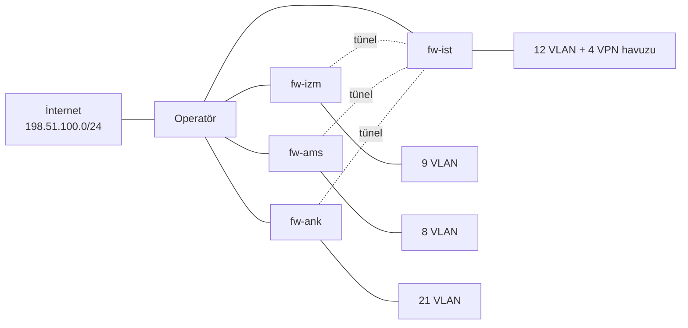

# Kural laboratuvarı

Bu klasör `company.json` kurallarını iki ayrı yöntemle sınar. Sonuçları ayrı raporlanır, çünkü farklı şeyler kanıtlarlar.

| Yöntem | Ne yapar? | Ne kanıtlar? | Sonuç |
|---|---|---|---|
| **Model** | Kuralları ilk eşleşme mantığıyla hesaplar, paket göndermez | Kural seti gereksinimlerle ve README ile tutarlıdır | [sonuclar/MODEL.md](sonuclar/MODEL.md) |
| **Gerçek Linux paketi** | Kuralları nftables ile yükler, gerçek TCP/UDP bağlantısı açar | Aynı kurallar çalışan bir L3/L4 güvenlik duvarında beklenen sonucu verir | [sonuclar/PAKET.md](sonuclar/PAKET.md) |

**İkisi de FortiGate değildir.** Bu testler IPS, uygulama tanıma, TLS denetimi, IPsec, HA, SD-WAN, hız sınırı veya WAF davranışını doğrulamaz. Sınırların tamamı aşağıdadır.

Gereken araçlar küçük tutuldu: dersin araçları gibi yalnızca standart kütüphane kullanan bir Python betiği, Bash, iproute2, nftables ve netcat. Test çerçevesi yoktur.

## Çalıştırma

```bash
# Model ve tutarlılık. Root gerekmez, her işletim sisteminde çalışır.
python3 lab/politika.py hepsi

# Gerçek paket testi. Linux ve root gerekir, yaklaşık 3 dakika sürer.
sudo apt install nftables iproute2 netcat-openbsd python3
sudo bash lab/lab.sh hepsi
```

Windows'ta paket testi WSL2 içinde çalışır:

```powershell
wsl -d Ubuntu -u root --exec bash /mnt/d/firewallProje/lab/lab.sh hepsi
```

Çıkış kodu `0` her şeyin geçtiğini, `1` kalan test olduğunu, `2` testin çalıştırılamadığını gösterir.

Paket testi yalnızca Linux ağ isim alanlarında çalışır. İsim alanlarının gerçek ağa bağlantısı yoktur, ana makinenin güvenlik duvarı ve ağ ayarları değişmez. Bitince hepsi silinir.

Elle denemek için:

```bash
sudo bash lab/lab.sh kur
sudo ip netns exec atl-ank-v100 nc -zv -w 1 -s 10.4.128.100 10.4.70.10 443
sudo ip netns exec atl-ank-v100 nc -zv -w 1 -s 10.4.128.100 10.4.60.31 443
sudo ip netns exec atl-fw-ank nft list chain inet atlas ileri
sudo bash lab/lab.sh temizle
```

## Gereksinimler

[gereksinimler.txt](gereksinimler.txt) bu güvenlik gereksinimlerinden **elle** yazılmıştır. Beklenen sonuçlar kurallardan üretilmez ve kural numarası içermez. Test kalırsa beklenen değer gevşetilmez: ya kural yanlıştır ya da gereksinim bilinçli olarak değiştirilir.

| No | Gereksinim |
|---|---|
| G1 | Öğrenci LMS'e ve internette web'e çıkar. ERP'ye, yönetime, diğer şubelere ve başka binadaki öğrencilere ulaşamaz |
| G2 | Misafir yalnızca internete çıkar, hiçbir iç ağı göremez |
| G3 | Ar-Ge internete yalnızca proxy ile çıkar, doğrudan çıkış hemen hata alır |
| G4 | Her VPN profili yalnızca kendi servisine ulaşır |
| G5 | Ağ cihazları yalnızca bastion'dan yönetilir, izleme kesilmez, internetten yönetim yoktur |
| G6 | İnternetten yalnızca WAF'a ulaşılır, uygulama ve veritabanına doğrudan ulaşılamaz |
| G7 | Şube merkez hizmetlerine iki uçtaki izinle ve merkez üzerinden ulaşır, şubeden şubeye geçemez |
| G8 | DHCP, DNS ve NTP bütün ret kurallarından önce çalışır |
| G9 | Açıkça izin verilmeyen trafik geçmez |
| G10 | Amsterdam'daki kişisel veri ve loglar Hollanda dışına çıkmaz |
| G11 | Bir sunucu segmenti ele geçirilirse diğerlerine yayılamaz |
| G12 | Cihaz, sunucu ve WAF logları toplayıcıya ulaşır |
| G13 | Normal iş akışları kesilmez |

## Model ne denetler?

`politika.py` gereksinim testlerinin yanında şunları denetler:

- **Nesneler:** `company.json` içindeki her adres [nesneler.json](../nesneler.json) içinde tanımlıdır. Grup üyeleri çözülür, gerçek WAN adresi tutulmaz.
- **Ağ:** VLAN'lar şube bloğunun içindedir ve çakışmaz. Öğrenci `/20` ağları `10.4.128.0/17` bloğunu tam olarak böler, `/17` VLAN olarak kullanılmaz, kapasite yeniden hesaplanır.
- **Kural yapısı:** Son satır varsayılan rettir, O1-O6 şube kurallarından öncedir, tamamen gölgelenen kural yoktur, port listesi veya `out` yönü yoktur.
- **İki uç:** Şubeler arası her izin uçtan uca hesaplanır. Tek taraflı izin hatadır.
- **README ile aynılık:** Kural tablolarındaki nesneler açılır ve `company.json` ile sıra sıra karşılaştırılır. VLAN tabloları, maliyet toplamı, NGFW profil bağları ve belgelerde geçen sunucu adresleri de denetlenir.
- **Bozma deneyleri:** Kurallar bellekte bozulur, örneğin eski öğrenci kuralı geri konur. Testler bunu yakalamazsa model hata verir.

## Paket testi nasıl çalışır?



Her güvenlik duvarı ve her VLAN ayrı bir ağ isim alanıdır, toplam 60 tane. Kurallar **`company.json` dosyasından üretilir**, elle yazılmaz. Önceki sürümde kurallar elle yazılıyordu ve bu yüzden lab `company.json` içindeki öğrenci kuralı hatasını göremedi.

1. **Kontrol:** Kurallar devre dışıyken her test yolunun açık olduğu doğrulanır. Böylece sonraki bir "red" sonucunun kopuk bağlantıdan veya kapalı porttan gelmediği bilinir. Bu aşama geçmezse testler çalıştırılmaz.
2. **Gereksinim testleri:** Her test gerçek bir TCP bağlantısı açar veya UDP paketi gönderir. UDP'de paketin ulaştığı, hedefin aldığı jetonla kanıtlanır. Sayaçlardan kararı veren kural da kaydedilir. Engellenen trafikte kural sayacı artmadıysa test kalır.
3. **Bozma deneyleri:** Kurallar gerçekten bozulur ve sonuç ölçülür.
4. **Aynı VLAN:** Dört sunucu tek köprüye bağlanır. Sunucu güvenlik duvarı yokken ERP'nin Git'e ulaştığı, açıkken ulaşamadığı ölçülür. Çevre güvenlik duvarının bu trafiği göremediğini gösterir.

Operatör özel adresleri de güvenlik duvarına yönlendirir. Bu sayede "internetten iç ağa erişilemez" sonucunu yönlendirme eksikliği değil, güvenlik duvarının kendisi üretir.

## Lab'in kullandığı varsayımlar

Bunlar yalnızca lab içindir, tasarım kararı veya gerçek adres değildir ([lab-degerleri.txt](lab-degerleri.txt)).

| Konu | Lab değeri | Tasarımdaki durum |
|---|---|---|
| WAN adresleri | `203.0.113.1`-`4` (belgeleme adresi) | Kurulum girdisi, tanımlı değil |
| Onaylı FQDN'ler | `198.51.100.20`-`31` (belgeleme adresi) | Cihazda FQDN nesnesi |
| Ağ geçitleri | Öğrenci VLAN'larında `.1`, diğerlerinde son adres | Öğrenci dışındakiler kurulumda belirlenir |
| `limit` kuralları | Hız sınırı uygulanmadan izin | Bağlantı hızı sınırı sınanmaz |
| IPsec tünelleri | Şifresiz doğrudan bağlantı | IPsec parametreleri henüz yazılmadı |

## Sınırlar

Bu lab L3/L4 kural mantığını sınar. Bir testin geçmesi FortiGate'te de aynı sonucun çıkacağını garanti etmez.

| Sınanmayan | Neden önemli? | Nerede doğrulanır? |
|---|---|---|
| Uygulama tanıma ve P2P engeli | `up-ogrenci` profili L3/L4 değildir. Testler yalnızca web dışı portların kapalı olduğunu gösterir, torrent'in engellendiğini göstermez | Gerçek FortiGate |
| IPS, antivirüs, TLS denetimi, web filtresi | Trafik içeriğine bakılmaz | Gerçek FortiGate |
| IPsec | Tüneller şifresizdir. UDP 500 ve 4500 için yalnızca kural sınanır | Gerçek FortiGate |
| HA ve SD-WAN | Cihaz ve hat arızası testleri yoktur | Gerçek FortiGate |
| Hız sınırı ve trafik şekillendirme | Uygulanmaz, ölçülmez | Gerçek FortiGate |
| DHCP relay | Unicast UDP 67 ile temsil edilir. FortiGate'te relay trafiği cihazın kendisinden çıkabilir | Gerçek FortiGate |
| WAF | Paket testinde yok. Gerçek ModSecurity yalnızca [waf/sonuclar/DUMAN.md](../waf/sonuclar/DUMAN.md) içinde çalıştı | Kabul testi |
| Log ve alarm | Sayaçlar kuralın çalıştığını gösterir, alarmın üretildiğini göstermez | Kurulum testi |
| Kaynak adres sahteciliği | Kurallar kaynak adrese bakar, sahte adres denenmez | Gerçek FortiGate |
| Dış WAN adresine göre tünel kuralı | Lab belgeleme adresi kullanır | Kurulum girdisi gelince |

Şube test tablolarında her satırın durumu yazılıdır. Çalıştırılmayan satırlar **Çalıştırılmadı** olarak işaretlidir.

## Teslim kontrolleri

Dersin doğrulayıcısı, sağlık denetimi ve kural üreticisi [teslim-kontrol.sh](teslim-kontrol.sh) ile çalıştırılır, sonucu [sonuclar/TESLIM.md](sonuclar/TESLIM.md) dosyasına yazılır. Bu betik `os-lab` deposuna bir şey göndermez.

**Sağlık denetiminin puanı güvenlik kanıtı değildir.** Denetim çoğunlukla metinde anahtar kelime arar. Bu projenin öğrencilerin bütün internetini kesen eski sürümü de 100/100 almıştı.

## Dosyalar

| Dosya | Görev |
|---|---|
| [politika.py](politika.py) | Tutarlılık denetimi, model ve nftables üretimi |
| [lab.sh](lab.sh) | Paket testi: kurulum, test, deney, rapor, temizlik |
| [gereksinimler.txt](gereksinimler.txt) | Elle yazılmış güvenlik gereksinimi testleri |
| [topoloji.txt](topoloji.txt) | Lab için VLAN ve adres listesi |
| [lab-degerleri.txt](lab-degerleri.txt) | Lab'e özel belgeleme adresleri |
| [teslim-kontrol.sh](teslim-kontrol.sh) | Dersin araçlarıyla teslim kontrolü |
| [sonuclar/](sonuclar/) | Üretilen raporlar ve ham sonuçlar |
